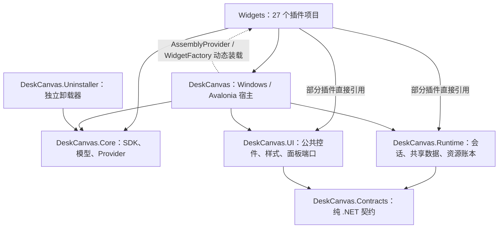
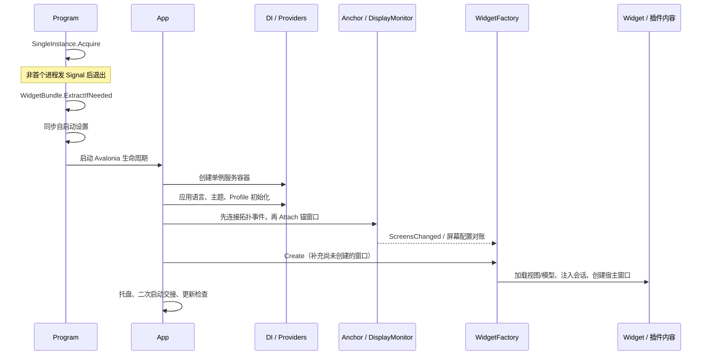
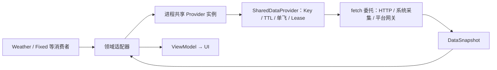

# DeskCanvas 项目解析报告

> 核对日期：2026-10-17。本文依据当前工作区源码、项目引用和验证脚本整理；工作区包含未提交改动，不能把本文所有实现归属于 Git HEAD。
>
> 本文回答“项目如何运转、代码放在哪里、扩展从哪里接入”。新增和修改代码的强制约束见 [开发规范](开发规范.md)。

## 1. 项目定位与核对口径

DeskCanvas 是 Windows 常驻桌面小组件宿主。它以动态插件提供时钟、天气、日历、清单、文件快捷访问和系统监控等内容，通过统一窗口、网格、多屏配置、主题与面板机制呈现。

应用不是一个主窗口里堆多个卡片：桌面组件通常各有一个原生窗口，设置窗口按需打开，另有二级面板和不可见锚窗口。维护时需同时理解 Avalonia 视觉树与 Windows 窗口行为。

| 项目 | 当前源码事实 |
|---|---|
| 主程序版本 | `src/DeskCanvas/AssemblyInfo.cs`：`3.8.3` |
| 技术栈 | C#、.NET 8、Avalonia 11.1.3、SkiaSharp 2.88.8、ReactiveUI、Microsoft DI、System.Text.Json |
| 平台 | Windows；宿主声明 win-x86、win-x64、win-arm64，构建默认 win-x64 |
| 源码工程 | `src` 下 33 个 csproj：宿主、Core、Contracts、Runtime、UI、独立卸载器和 27 个插件 |
| 插件/视图 | 27 个插件项目，`AssemblyInfo.cs` 中 45 条 `WidgetInfo` 视图注册；项目数与视图数不同 |
| 检查工程 | `tests` 下 62 个 csproj，包含正式门禁与探针 |
| 统一验证 | `verify.ps1` 登记 39 步：2 个守卫、1 个 Debug 构建、36 个 Release 检查 |
| 数据 | 文件式 JSON 与本地缓存；活动配置放在 `Profiles/<active>/` |
| 交付 | 框架依赖的单文件 EXE，可选 Portable ZIP、Inno Setup、WiX MSI |

上述数字是本次目录统计，不是恒定产品指标。源码优先于旧 README/历史报告中的版本、组件数量和布局格式描述。本次文档编写不构成全套门禁、安装或真机验收通过记录。

## 2. 架构总图

下图实线表示当前 `ProjectReference` 方向，虚线表示运行时装载/调用。平台能力与存储不作为项目引用节点混在图中。



关键判断：

- 宿主没有静态引用具体插件，插件由文件和注册元数据发现；插件目前仍引用宿主公开类型，因此存在编译依赖和运行时回调两个方向。
- Core 和 Contracts 目前是两条独立契约线，不能把 Core 画成已依赖 Contracts。
- Runtime 和 UI 各自只引用 Contracts，没有相互依赖；UI 不负责取数，Runtime 不负责控件。
- Windows 平台适配主要仍在宿主，部分网关保留在 Music、ControlCenter 等插件。仓库当前没有独立的 `DeskCanvas.Platform.Windows` 工程。

## 3. 目录地图与职责

```text
DeskCanvas/
├─ doc/                         本次整理的开发规范与项目解析
├─ docs/                        仓库原有文档/视觉实验约定路径
├─ src/
│  ├─ DeskCanvas.sln
│  ├─ DeskCanvas/               宿主、窗口、平台适配与应用编排
│  │  ├─ Program.cs
│  │  ├─ App.axaml(.cs)
│  │  ├─ Services/
│  │  ├─ Views/                 Widget、Settings、SecondaryPanelWindow
│  │  │  ├─ Controls/           宿主专用控件及公共控件兼容门面
│  │  │  └─ Pages/              设置页面
│  │  ├─ ViewModels/
│  │  ├─ Styles/                材质/语义资源、共享资源兼容 URI
│  │  └─ Locales/
│  ├─ DeskCanvas.Contracts/     生命周期、活动、调度、资源/设置契约
│  ├─ DeskCanvas.Core/          插件 SDK 与配置/布局基础服务
│  ├─ DeskCanvas.Runtime/       会话、共享数据、时区、设置事务、账本
│  ├─ DeskCanvas.UI/            公共控件、Styles、Samples
│  ├─ DeskCanvas.Uninstaller/   独立卸载程序
│  └─ Widgets/<Name>/           27 个独立插件
├─ tests/                       Checks 与诊断/截图探针
├─ scripts/                     结构、UI、验证、发布与插件打包脚本
├─ installer/                   Inno Setup / WiX 输入
├─ .github/                     工作流、图标和项目模板
├─ Directory.Build.props        共享编译默认值
├─ Directory.Packages.props     NuGet 版本单一来源
├─ build.ps1                    发布与可选安装包入口
└─ dist/                        本地生成物，不是源码
```

### 3.1 宿主

`DeskCanvas` 同时扮演装配根和 Windows 适配层，主要包含：

| 子系统 | 核心文件/类型 | 职责 |
|---|---|---|
| 入口 | `Program`、`SingleInstance`、`WidgetBundle` | 单实例交接、插件解包、自启动、Avalonia 启动 |
| 装配 | `App.axaml.cs` | DI、主题/语言、显示器事件、托盘、更新检查 |
| 组件管理 | `WidgetFactory`、`Views/Widget`、`WidgetContentHost` | 按布局创建窗口、注入内容/会话、重建、关闭与挂起 |
| 屏幕与网格 | `DisplayMonitorService`、`GridService`、`GridMetrics`、`SizeTiers` | 物理屏身份、拓扑稳定、DPI、吸附、跨度和内容档位 |
| 主题 | `ThemeService`、`ThemeProfileResolver`、`ThemeScopeResolver`、`FocusThemeCoordinator` | 主题投影、资源作用域、每屏失焦变体 |
| 面板 | `PanelService`、`SecondaryPanelWindow`、`PanelAppearanceResolver` | owner、单例范围、冷却、层级、共享外观和开合 |
| 原生行为 | `InteropService`、`WidgetZOrder`、`WindowRoles` | HWND、原生裁剪、底部窗口带、角色记录 |
| 配置方案 | `ProfileService`、`DataFolderService`、`BackupService` | 方案目录、热切换、数据根指针、备份/导入 |
| 数据装配 | `SharedDataServices`、`NativeSystemMetrics` | 进程级共享实例与平台采集 |
| 维护 | `MemoryTrimmerService`、`GlassDiagnostics`、`UpdateService` | 按需内存维护、诊断与更新 |

### 3.2 Core 与 Contracts

Core 是现存插件 SDK：`WidgetInfoAttribute`、`LocaleAttribute`、`IWidgetFactory`、设置/布局 Provider、`WidgetLayout`、`ScreensLayout`、`Theme`、`Const`、`JsonParser<T>` 等。

Contracts 提供较新的中立边界：`IWidgetSession`、`ActivitySnapshot`、`WidgetInstanceId`、`DataSnapshot<T>`、资源账本与压力模型、调度请求和设置快照。两者没有合并；引用时必须看完整命名空间，尤其是两套同名 `IWidgetScheduler`。

### 3.3 Runtime 与 UI

Runtime 提供可被宿主和插件复用的实现：

- `WidgetSession` / `WidgetSessionRegistry`：生命周期串行化、取消范围、活动记录。
- `SharedDataProvider<TKey,TValue>`：同键请求合并、TTL、Owner Lease 和统计。
- 天气、系统指标、磁盘、媒体快照包装提供器。
- `SharedTimeZone`：时区解析缓存；虽然文件名为 `TimeSource.cs`，实际不是全局时间服务。
- `PersistentSettingsSession<T>`：草稿、版本冲突、持久化成功后发布。
- `ResourceLedger`：有界资源观测表。

UI 提供真实控件、资源和端口：`Setting`、`SettingLayoutPanel`、`LabeledSlider`、`ColorInput`、`SecondaryPanelShell`、`GlassSurfaceBase`、`dc-*` 样式、DesignTokens，以及可嵌入样例目录。

它们的边界是“UI 接收数据与属性；Runtime 返回快照和租约”。共享逻辑不会自动装配到每个组件，生产消费者仍需要明确引用和接线。

## 4. 启动链与 DI 装配



DI 主要注册设置/布局/程序集 Provider、主题/语言/网格、多屏、全屏/失焦监听、`WidgetFactory`、`ProfileService`、`Settings` 和 `UpdateService`。

`Settings` 与 `Func<Settings>` 解析的是同一个单例，按需创建。不是每个组件打开一份设置窗口。桌面生命周期使用 `OnExplicitShutdown`；没有主组件时会自动打开设置，常规入口由托盘提供。

不是所有共享能力都在 DI 中注册：`TimerService`、`SharedDataServices`、`WidgetSessionRegistry`、`PanelService` 和账本目前存在静态入口。理解这一点可以避免错误地假定 `GetRequiredService<IWidgetScheduler>()` 等调用已可用。

不可见的 `WidgetAnchorWindow` 保证即使没有组件/设置窗口，也有一个 Avalonia TopLevel 可枚举屏幕并监听变化。连接顺序重要：必须先订阅拓扑变化，再执行首次 Attach/Refresh，避免漏掉第一次屏幕对账。

## 5. 插件发现、加载与窗口创建

### 5.1 注册与身份

每个插件的 `AssemblyInfo.cs` 包含一个或多个 `WidgetInfo`：视图类型、设置模型类型、编辑视图、标题/说明资源键、默认格跨度和可选预设跨度。`Locale` 属性提供插件名称和图标等元数据。

`layout.json` 中：

- `Type` 是程序集名，不一定等于目录名。
- `SubType` 是注册视图的类型名。
- `Settings` 是组件模型的 JSON。
- `InstanceId` 标识组件实例；`Generation` 用于代次控制。

`Fixed` 和 `Stack` 的程序集名分别为 `FixedWidgets`、`StackWidgets`。这些名称进入持久化数据，不能为了统一目录命名随意重命名。

### 5.2 装载与激活

`AssemblyProvider` 扫描 `Const.WidgetsFolder` 的候选 DLL，过滤框架/依赖程序集，读取注册属性并缓存元数据。按名称加载时使用可回收 `AssemblyLoadContext`，同名候选按版本选择；依赖优先复用默认上下文中的共享程序集，再使用依赖解析和同目录探测。

激活通过 `ActivatorUtilities` 和兼容回退组合显式参数、DI 服务、默认参数。不能把反射类型当作死代码裁剪；发布不得开启 trimming。

“可回收上下文”表示具备卸载机制，不表示插件实例关闭后一定卸载了 DLL；事件、静态字段、类型缓存或窗口引用仍可能保活。

### 5.3 从布局创建窗口

`WidgetFactory.CreateInternal` 的核心顺序：

1. 为组件创建 `WidgetLayoutProvider`，绑定屏幕与布局身份。
2. 有稳定身份时从 `WidgetSessionRegistry` 获取会话。
3. 按 `Type` 加载程序集、按 `SubType` 查找 `WidgetInfo`。
4. 反序列化设置模型；缺省模型尽量默认构造，使完整 DI 构造函数可达。
5. 内容构造时按参数探测注入 `IWidgetLayoutProvider` 和 `IWidgetSession`。
6. 创建宿主 `Widget` 窗口，交给内容工厂、统一设置窗口和可选编辑窗口。
7. 把窗口登记到屏幕集合，关闭时移除；最后一个组件退出后释放共享材质缓存。

组件库预览走 `CreateControl`：使用临时布局身份、统一 `WidgetContentHost.Prepare`，有意不登记全局会话。预览需要无持久化写入和明确释放；不能按“桌面会话必定存在”编写视图。

替换磁盘 DLL 后下一次加载/重启可以使用新包；当前没有可据此宣称“运行中任意替换立即生效”的全量热重载协议。

## 6. 生命周期、共享数据与调度

### 6.1 活动推送

宿主窗口记录 `ActivitySnapshot` 到会话，再在 UI 线程调用内容的 `IWidgetActivityConsumer.OnSessionActivity`。组件据此对账订阅、暂停轮询或恢复绘制。会话状态机大致为：

```text
Created → Initializing → Ready → Disposing → Disposed
                      ↘ Faulted（初始化失败；可按实现重新初始化）
```

`WidgetSession` 用门锁串行化初始化、设置应用、活动和释放，并拥有取消范围与 Generation。注册表创建的生产会话主要用于活动记录，不能把它理解为已经自动托管所有插件后台任务。

不同 Activity 属性分别控制可见绘制、普通轮询和业务截止任务。部分纯交互组件无需周期活动订阅；保留无会话兼容路径也不代表遗漏，应按是否拥有后台工作判断。

`IWidgetSelfRefreshing` 允许原位刷新设置，避免输入会话被销毁。`IWidgetSuspendable` 让高成本内容释放可重建资源。销毁时仍需消费者主动解除事件、监听和租约。

### 6.2 数据流



共享必须发生在**同一个 Provider 实例 + 相同请求 Key**。每个视图各自 new Provider 不会形成跨组件单飞。

| 来源 | 装配位置 | 消费方式 |
|---|---|---|
| Open-Meteo 预报/空气质量/城市查询 | `SharedDataServices.Weather` | Weather 领域适配器和 Fixed 等入口复用完整响应 |
| 系统指标 | `SharedDataServices.SystemMetrics` | 宿主 `NativeSystemMetrics` 提供实际读取，Monitor 消费 |
| 磁盘卷 | `SharedDataServices.Storage` | 一次共享枚举，再由 Storage 展示投影 |
| 媒体会话 | Music 的 `MediaManagerService` | 每来源共享引擎/SMTC 网关，普通快照进入 Runtime |
| 时区 | `SharedTimeZone.Resolve` | 本地/null、Windows/IANA ID 和非法值回退规则统一 |

通用提供器会合并在途请求、复用未过期结果、统计请求/命中/合并/失败/活动 Owner。Owner 的 Lease 结束不会打断其他消费者；请求失败会释放自己的等待关系。

底层 fetch 使用独立取消策略，当前通用引擎调用 fetch 时不传递单个 caller 的 Token。因此超时要在 fetch/客户端层设置，不能把“取消一个组件”等同于“终止共享 I/O”。

### 6.3 定时现状

- 生产多数刷新使用宿主 `TimerService` / `UpdateTimer` 的共享节拍；订阅者可对账退出，全屏时宿主统一暂停。
- `DeskCanvas.Core.Scheduling.WidgetScheduler` 有独立 owner/租约、统计、超时和暂停能力，但没有因类型存在就自动装配为全部组件的调度后端。
- `DeskCanvas.Contracts.IWidgetScheduler` 使用 `WidgetScheduleRequest`，签名与 Core 的同名接口不同，当前没有统一实现适配。
- 媒体、局部动画、防抖等仍有专用机制。它们是否正确要看生命周期和释放边界，不能只搜索“Timer”判断迁移完成。

后续统一调度应先定义适配和真实生产生命周期，再迁移消费者，避免出现第三套机制。

## 7. UI、主题、材质与二级面板

### 7.1 公共控件资源

`App.axaml` 装配 Fluent 基础主题、输入/图标/分组/面板样式、共享 `Controls.axaml`、设计 Token 和交互资源。UI 中 `dc-icon-button`、`dc-pill`、`dc-card-box`、`dc-badge` 等是标准视觉入口。

旧宿主同名控件、旧样式类名与资源 URI 保留兼容门面。共享实现已经存在，并不表示所有业务 XAML 的局部样式都已清除；新增代码不能以旧例为理由继续复制。

`GlassSurfaceBase` 只定义圆角、渲染请求和动画缩放端口。生产实现是宿主 `LiquidGlassSurface`，共享 UI 不知道壁纸采集、GPU 或 Theme 存储模型。

### 7.2 主题作用域

应用设置进入 `ThemeService`，由 `ThemeProfileResolver` 输出归一化的 `ResolvedThemeProfile`。`FocusWatchService` 判断屏幕被应用窗口占用情况，`FocusThemeCoordinator` 协调本屏主题和窗口资源。

`ThemeScopeResolver` 按“控件/逻辑树 → 所属窗口 → Application”找资源。组件读全局明暗而忽略窗口变体，会在每屏主题或失焦联动时出现不一致。

当前 `SurfaceStyle` 有三个不同值：

| 值 | 名称 | 含义 |
|---|---|---|
| 0 | `Acrylic` | 系统亚克力材质 |
| 2 | `LiquidGlass` | 应用自绘折射玻璃；`LiquidGlassV2` 为别名 |
| 4 | `FullColor` | 全彩业务色板；`Colorful` 为别名 |

旧资料中的 Solid、OutlinedAcrylic、SoftGlow 等不能当作当前枚举成员使用。历史数据兼容是单独需要验证的范围，不应根据旧文章推定可无损回退。

### 7.3 玻璃管线

`LiquidGlassWallpaper` 提供共享壁纸/桌面来源，`LiquidGlassSource` 管理背景与租约等共享资源，`LiquidGlassSurface` 消费材质并绘制。`LiquidGlassEffect` 提供 Skia 运行时 GPU 着色，`LiquidGlassRenderer` 提供 CPU 渲染/回退与字形帧用途。

关键约束是采样源、纹理、像素尺度、颜色参数、缓存 owner 和释放线程保持一致。调整材质需要同时验证 CPU/GPU 和共享缓存，不能在一个插件里修一份折射公式。

### 7.4 面板职责

`PanelService` 管理打开身份、作用域、重复点击关闭、冷却和 owner 联动。`SecondaryPanelWindow` 处理原生定位、层级和开合；`SecondaryPanelShell` 负责卡片、标题、按钮和业务内容槽；`PanelAppearanceBinder` 将解析后的主题绑定给壳。

典型场景：天气面板 `PerOwner`，两个天气组件可以各有面板；明确进程单例的功能使用 `ProcessSingleton`。窗口根仍是 Window，Shell 是窗口内共享内容壳。

`WindowRoles` 记录 DesktopWidget、SecondaryPanel、Settings、Dialog、Preview、Anchor 等角色。它当前主要登记能力档案，不能代替真实的 Show、z-order、主题跟踪等调用。

## 8. 布局、多屏与持久化

### 8.1 布局格式

`ScreensLayout` 当前默认 Version 为 3；`LayoutProvider` 可读取旧 v1 扁平数组，包装为屏幕布局，补全组件稳定身份，并把版本归一化为至少 3。

```json
{
  "Version": 3,
  "Screens": [{
    "Id": "primary",
    "Key": null,
    "Alias": "主屏",
    "DeviceName": null,
    "Grid": null,
    "ContentScale": null,
    "Layout": [{
      "Type": "Clock",
      "SubType": "Digital",
      "X": 0,
      "Y": 0,
      "Width": 200,
      "Height": 200,
      "Settings": null,
      "ContentScale": null,
      "InstanceId": "1f098a37-3fb9-4b90-abcc-804a246fe89b",
      "Generation": 1
    }]
  }]
}
```

此片段展示结构，不是推荐布局或直接覆盖用户文件的模板。坐标解释受旧布局迁移、屏幕绑定和网格管线影响，不能跳过 Provider 直接改 JSON。

`WidgetLayout.IndexOfIdentity` 先比较对象引用，再比较稳定身份；Legacy 才使用类型/几何等回退。`JsonElement` 跨文档没有这里需要的结构相等性，不能靠整个 record Equals 查找组件。

### 8.2 多屏与 DPI

`DisplayMonitorService` 合并 Avalonia 屏幕几何和 Windows 设备身份，建立 `AttachedScreen` 与保存配置的匹配。拓扑变化经历通知、暂缓提交、稳定对账，防止 Windows/Avalonia 的临时结果把组件保存到错误屏幕。

`WidgetFactory` 在变更前暂时隐藏窗口、关闭二级面板，变更后处理离线/回归屏幕并恢复各自几何。离线屏幕的配置保留，而不是把其组件迁移到仍连接的主屏。

网格由 `GridMetrics` 解析，尺寸最终转为 DIP，原生窗口位置使用物理像素。`ScreenLayout.ContentScale` 是每屏值，组件的 `WidgetLayout.ContentScale` 优先覆盖。内容档位复用 `SizeTiers`；固定比例组件通过 `IFixedSizeWidget` 声明约束。

### 8.3 文件保存

`JsonParser<T>` 在同目录写临时文件并 flush，再执行替换；文件成功提交后才更新内存数据和 `DataChanged`。保存失败不得对上层报告成功。它不等于“每类业务 Store 都已自动原子化”，需逐消费者确认。

`WidgetLayoutProvider` 负责更新已有实例，发现条目已移除则拒绝追加；屏幕身份变化时可重定位已有条目。这是防止旧窗口在切换方案后把自己重新写回来的关键。

`PersistentSettingsSession<T>` 提供草稿和 revision 检查；`AppearanceSettingsSession` 是真实接线实例。不能推断所有组件编辑器都已迁入同一事务。

## 9. 数据根、配置方案与缓存

### 9.1 数据根解析

`Const.ResolveDataFolder` 按当前源码依次检查：

1. `DESKCANVAS_DATA_FOLDER`，兼容旧拼写 `DESCANVAS_DATA_FOLDER`。
2. 检查程序结构沙箱。
3. EXE 旁 `dataFolder.json`。
4. EXE 旁存在 Widgets 的便携规则；Debug 的用户数据转向 `%LocalAppData%\DeskCanvas-dev`。
5. 默认数据目录中的 `dataFolder.json` 锚指针。
6. `%LocalAppData%\DeskCanvas`，含旧应用目录迁移相关逻辑。

数据根在启动期确定；通过 `DataFolderService` 修改后需重启。活动 Profile 在根内可热切换，两者不是同一种操作。

```text
DataFolder/
├─ dataFolder.json               仅在选用此处为指针锚点时存在
├─ activeProfile.json            {"ActiveProfile":"Default"}
├─ Widgets/                      打包模式下的已解包组件
└─ Profiles/
   ├─ Default/
   │  ├─ appSettings.json
   │  ├─ layout.json
   │  ├─ reminders.json
   │  ├─ timetable.json
   │  ├─ habits.json
   │  ├─ shortcuts.json
   │  ├─ countdown.json
   │  ├─ dice.json
   │  ├─ fortune.json
   │  └─ wheel.json
   └─ <其他方案>/
```

Widgets 实际加载路径由 `Const.WidgetsFolder` 单独解析，便携/开发模式可优先使用 EXE 旁目录，不能简单把它等同于 ActiveProfileFolder 的子目录。

地图、剪贴板、诊断与更新等现存缓存各有 LocalAppData/Temp 策略，不能宣称“所有数据都已搬进 Profile”。新增用户业务数据必须明确方案作用域，新增缓存明确容量、路径和清理方式。

### 9.2 Profile 热切换

`ProfileService.SwitchProfile`：

```text
保存当前设置和布局
→ CloseAll（面板关闭、窗口停止订阅、旧会话拆除）
→ Const.SetActiveProfile（写指针并通知 Store）
→ Reload 设置/布局 Provider
→ 刷新屏幕配置
→ 应用目标语言/主题
→ CreateFromLayout
→ 通知界面并请求一次延迟维护
```

Store 需要清缓存和重绑文件监听，长任务结果需要校验当前 Profile。路径可变不代表后台闭包会自动绑定到新方案。

## 10. 资源、全屏与内存维护

`FullscreenWatcherService` 监视覆盖情况，调用 `WidgetFactory.SuspendAll/ResumeAll`。当前暂停实现会停止共享 Timer、调用组件 Suspend、隐藏组件，并释放共享捕获/背景；恢复时显示、重建并恢复节拍。部分注释仍描述“窗口不隐藏”，维护时以实际执行代码为准。

`ResourceLedger` 按 owner/kind 记录绝对数量与估算像素字节，并限制每类 owner 行数。当前主要接入玻璃、图片与字形；部分资源类型保留占位。它是观测设施，不会替消费者释放资源。

`ResourcePressureEvaluator` 有分级与迟滞，现有消费者用于调整维护强度/闲置释放。预算和阈值仍是实验参数，需要真实设备负载标定。

`MemoryTrimmerService` 在组件关闭、全屏、Profile 切换、设置窗口释放等明确释放事件后按需维护，带单飞、冷却和阈值。工作集下降不等价于引用已释放，排查泄漏仍需检查订阅、Lease、像素缓存和静态集合。

## 11. 插件目录

下表覆盖当前 27 个项目；分组只帮助导航，不构成插件互相引用的许可。

| 类别 | 项目 | 内容 |
|---|---|---|
| 时间与日程 | Clock、Calendar、Countdown、Timetable、Pomodoro、Progress | 时钟、日期/月历、倒计时、课表、番茄钟与时间进度 |
| 个人记录 | Notes、Reminders、Habits | 笔记、提醒清单与习惯 |
| 信息与媒体 | Weather、Hitokoto、Picture、Music、Map | 天气、一言、图片、媒体会话与地图 |
| 系统与设备 | Monitor、Batteries、Storage、ControlCenter | 系统指标、电池、存储和控制入口 |
| 快捷访问与工具 | Folders、Search、Shortcuts、Tools | 文件快捷访问、搜索、工作流与剪贴板/翻译/计算器 |
| 容器与聚合 | Fixed、Stack | 聚合卡片、组件堆叠 |
| 互动 | Dice | 掷骰子 |

典型阅读样本：

- 公共 UI：`src/DeskCanvas.UI/Samples/SharedComponentCatalog.cs`。
- 跨组件取数：`Services/SharedDataServices.cs` + Weather 的 `OpenMeteoWeatherProvider` + Monitor 的 `MetricService`。
- 会话接入：Clock 的 `Digital` / `DigitalClockViewModel`、Calendar 视图。
- 面板接入：Weather 的 `WeatherPopupWindow` 及 `PanelService` 调用。
- 保存事务：`AppearanceSettingsSession`、`PersistentSettingsSession<T>`、`JsonParser<T>`。

这些文件说明某一接入路径，不意味着其所有局部文案或历史代码都是新组件规范范本；实现要求以开发规范为准。

## 12. 构建、分发与卸载

`Directory.Build.props` 统一可空、隐式 using、编译绑定、源码程序集信息和插件动态加载默认值。`Directory.Packages.props` 是依赖版本源。

常用命令：

```powershell
dotnet build .\src\DeskCanvas.sln -c Debug
pwsh -NoProfile -ExecutionPolicy Bypass -File .\build.ps1
pwsh -NoProfile -ExecutionPolicy Bypass -File .\build.ps1 -Portable
pwsh -NoProfile -ExecutionPolicy Bypass -File .\build.ps1 -Setup
pwsh -NoProfile -ExecutionPolicy Bypass -File .\build.ps1 -Msi
```

发布链为：

```text
build.ps1
→ dotnet publish（RID / Release / 框架依赖单文件）
→ 宿主 BuildWidgetsBundle MSBuild 目标
→ scripts/build-widgets-bundle.ps1 发现并发布插件
→ 扁平 staging → widgets.zip → EmbeddedResource
→ 输出 DeskCanvas.exe
→ 按参数追加便携 ZIP / Inno Setup / MSI
```

`WidgetBundle.ExtractIfNeeded` 首次运行补齐缺失默认设置，把嵌入插件包解到 Widgets。`.version` 保存的是嵌入 ZIP 的 SHA-256 内容哈希，不是应用版本号；插件内容变化会触发重新解包。

插件输出避免携带宿主/Core/Avalonia 副本，保留依赖解析所需信息。某些 Windows 专属插件目标框架与普通插件不同，但仍输出到宿主统一 Widgets 目录。

Setup 使用 `installer/DeskCanvas.iss`，原生卸载器是 `unins000.exe`。仓库另外存在 `DeskCanvas.Uninstaller` 独立项目；About 页先查原生卸载器，再查 `DeskCanvasUninstaller.exe` 回退。**当前 build.ps1 没有据此自动发布独立卸载器的调用，项目存在与产物随包存在需分别确认。**

卸载默认保留用户数据；清理数据需明确选择；自启动删除须核对路径归属，不能删除另一个安装维护的共享状态。安装/卸载和代码签名结果必须来自具体产物实测，不能由源码推断。

## 13. 验证体系与证据边界

| 入口 | 用途 |
|---|---|
| `scripts/check-structure.ps1` | 项目依赖、插件注册、输出和运行时资产隔离、中央包版本 |
| `scripts/check-ui-conventions.ps1` | 通用样式重复、选区颜色、面板外壳、滚动归属、部分本地化与类型分支 |
| `scripts/verify.ps1` | 两项守卫 + Debug 构建 + 登记的 36 个 Release 程序 |
| `scripts/release-gate.ps1` | verify、公开 API、升级回退和设置释放；汇总到 dist |
| `tests/README.md` | 62 个检查工程分类与说明 |

正式门禁主要覆盖身份存储、会话、共享 UI、每屏主题、请求合并、面板归属、窗口角色、资源账本、Profile、卸载和 API 兼容。探针负责截图、性能、内存和复现，不应只因能运行就写成通过。

无头环境不验证真实 GPU/驱动、DWM、IME、原生拖动、外部点击、混合 DPI、热插拔或底部窗口带。跨版本 DLL 的真实二进制兼容也不能仅凭 API 快照推定成立。

本报告提供源码地图与静态事实，不沿用已经删除的旧收官文档中的“全绿”结论。当前运行结果应记录在具体执行日志和交付说明中。

## 14. 已有边界与后续收敛点

| 观察到的现状 | 对维护的影响 |
|---|---|
| 插件都仍引用宿主 | 新增功能优先走中立接口/公共控件，不能宣称宿主已完全解耦 |
| Core 与 Contracts 各有同名调度接口 | 使用完整命名空间，适配后再迁移，避免定义第三套 |
| 会话已接线但无会话路径保留 | 预览、Legacy 与纯交互组件要分别处理；删除前验证兼容 |
| 旧控件门面、资源 URI、样式别名与局部样式并存 | 新代码用公共入口；清理以真实消费者和视觉回归为依据 |
| 设置事务尚未覆盖所有编辑器 | 逐步明确 draft/commit，不在普通重构中悄悄改变保存时机 |
| 平台网关部分位于插件 | 抽取共享快照时保留平台边界，不把 WinRT/WMI 搬入 Runtime |
| 部分资源类型为占位、预算未标定 | 不把枚举项当已接入，不把实验参数写成发布指标 |
| 工作区包含未提交源码变更 | 架构报告是工作区快照，后续改动需同步维护项目引用、流程与统计 |

这些是已核对的边界和限制，不是本次文档工作已实施的代码修复。

## 15. 面向开发者的阅读路线

1. 先读 [开发规范](开发规范.md)，确定 UI、数据和生命周期的复用入口。
2. 读 `Program.cs` → `App.axaml.cs`，理解装配和启动顺序。
3. 读 `AssemblyProvider` → `WidgetFactory` → `Widget.axaml.cs`，理解插件与宿主窗口。
4. 读 `DeskCanvas.UI/Samples` 和相关共享样式，建立视觉基线。
5. 读 `SharedDataServices` / `SharedDataProvider` 和目标组件领域适配器，确认共享实例与请求键。
6. 读 `WidgetSessionRegistry`、`TimerService` 和目标组件 Activity 处理，确认暂停/恢复/释放。
7. 读 `Const`、`JsonParser`、`WidgetLayoutProvider`、`ProfileService`，明确数据路径、身份和热切换。
8. 按改动范围阅读 `tests/README.md` 和检查入口，先保住已有契约，再扩展业务。
