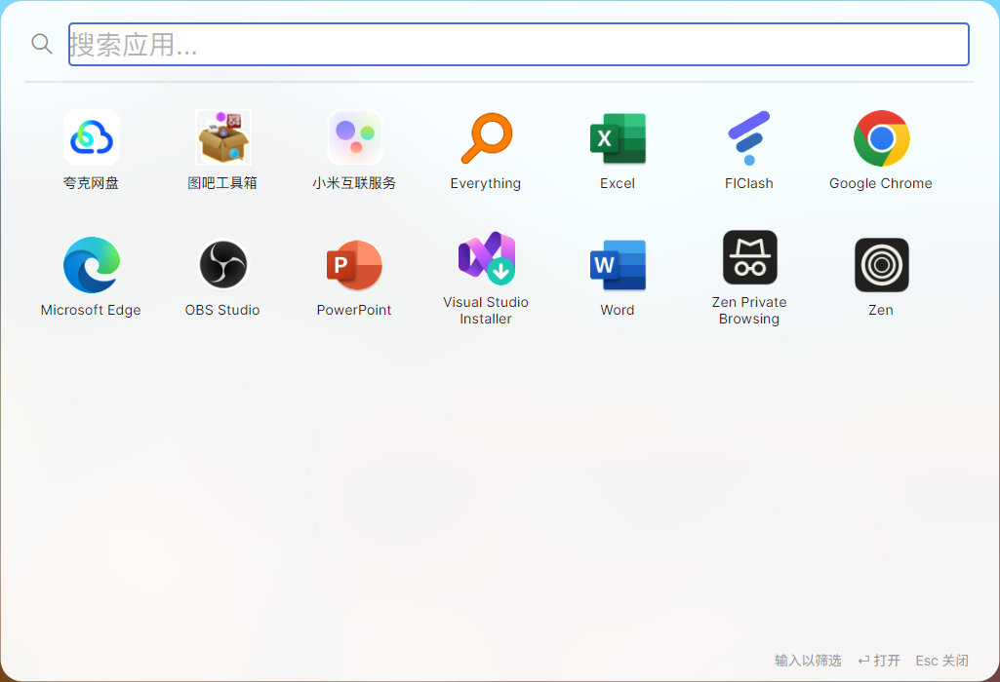
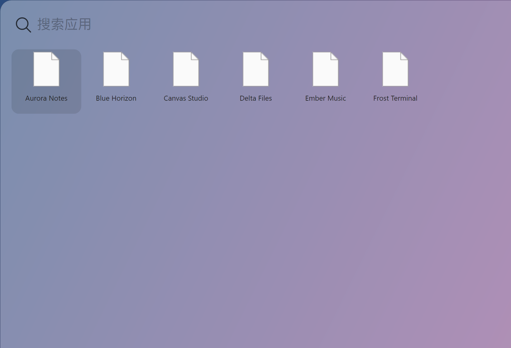
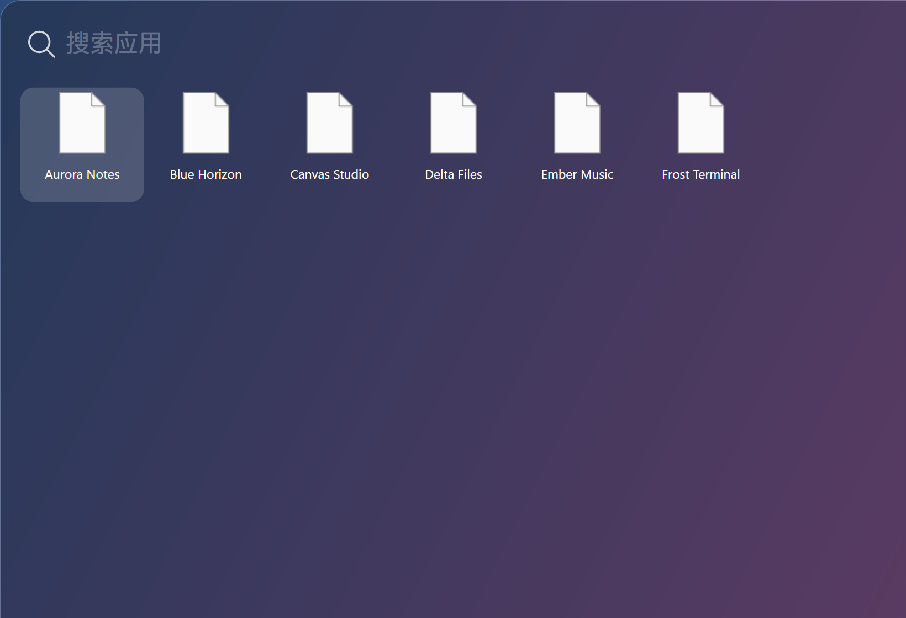
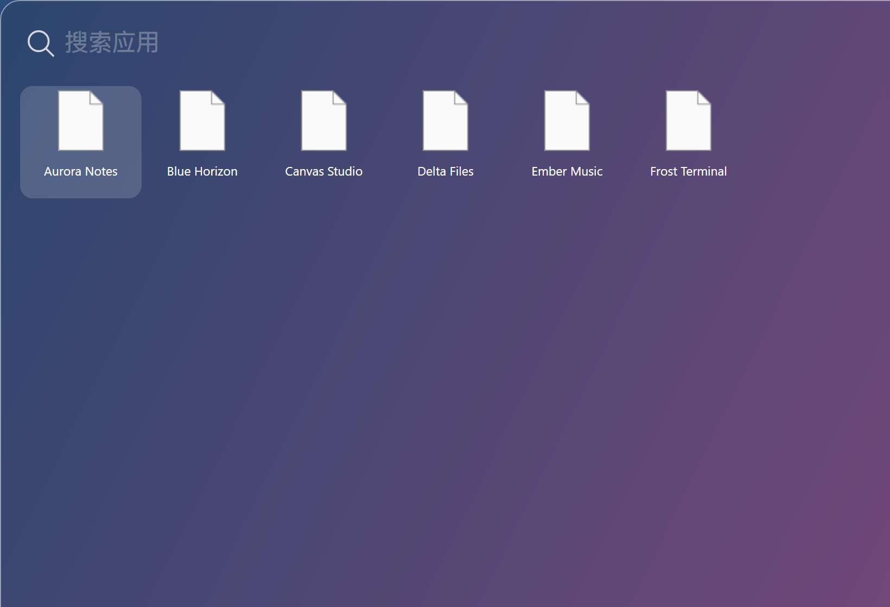
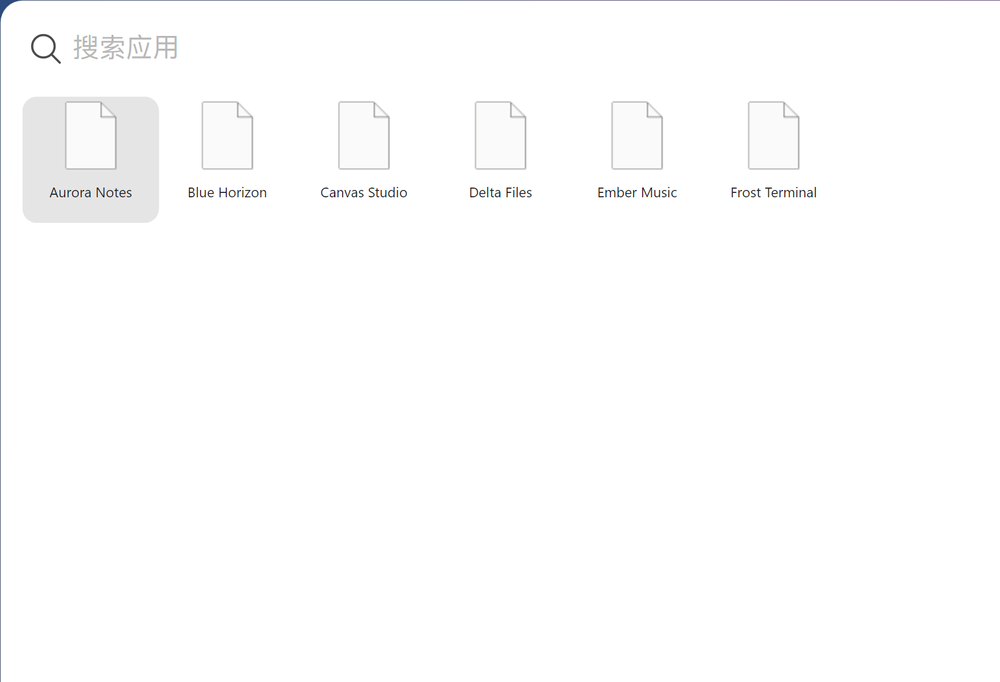
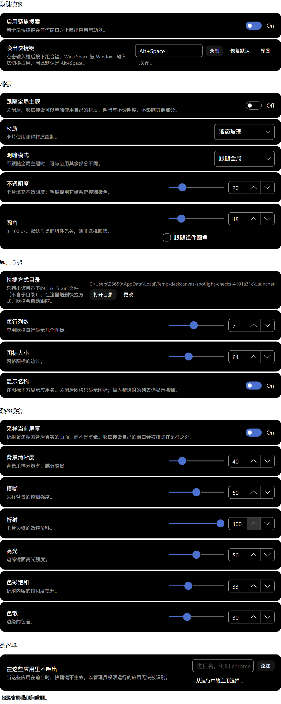

# 聚焦搜索（Spotlight 式启动器）可行性研究

> 核对日期：2026-10-20。依据：本工作区源码 + 一个可运行的独立探针（`doc/_scratch/spotlight-spike/`）。
> 本文回答“能不能做、做在哪一层、要动哪些文件、有哪些坑”，不是最终设计稿。新增代码的强制约束仍以 [开发规范](../doc/开发规范.md) 为准。

## 1. 结论

**技术上完全可行，而且核心链路已经被实测跑通**，不需要引入任何新依赖、新框架或新平台网关。

- 全局热键唤起、居中浮层、毛玻璃背景、失焦自动收起：已在本机实测通过（Alt+Space 注册成功，注入按键后窗口 6 ms 内弹出）。
- 用户自建快捷方式文件夹 → 网格陈列 → 图标 → 启动：已实测通过（14 个 `.lnk`，扫描 94 ms，图标 14/14 用时 255 ms）。
- 真正的工作量不在“能不能”，而在**产品取舍**（结果类型、排序、导入体验）和**宿主接线**（新窗口角色、热键归属、图标缓存、设置页、门禁）。

风险集中在一个地方：**这不是一个桌面组件，必须做在宿主层**。若试图塞进 `src/Widgets/`，会与现有窗口模型（底部窗口带、网格吸附、组件会话）正面冲突。

## 2. 需求定义

要做的其实是 macOS 26（Tahoe）之后的形态：**启动台被聚焦搜索吸收** —— 屏幕中部一个搜索条，下方直接陈列应用网格；输入即筛选，回车即打开。

用户补充的硬要求：**应用由用户自己导入**，即把快捷方式丢进一个指定文件夹，启动器只认这个文件夹。

这条要求反而让方案变简单了：

| 对比项 | 扫开始菜单（曾评估） | 用户自建文件夹（采用） |
|---|---|---|
| 数据源 | 两处 Start Menu + `shell:AppsFolder` | 一个目录下的 `*.lnk` / `*.url` |
| UWP 应用 | 需 AppUserModelID + `explorer shell:AppsFolder\...` 启动 | 不需要（用户自己拖快捷方式） |
| 结果可预期性 | 148 + 42 条，含 `{-brand-shortcut-name}`、`Uninstall Node.js` 等垃圾 | 用户放什么就显示什么 |
| 首屏耗时（实测） | 352 ms 索引 + 2.9 s 图标 | 94 ms 索引 + 0.26 s 图标（14 项） |
| 权限/兼容风险 | 打包应用枚举依赖 Shell COM 细节 | 纯文件系统 |

结论：**以文件夹为唯一数据源**，开始菜单扫描最多作为 P2 的“一键导入”辅助（把 `.lnk` 复制进文件夹），不进入运行时索引。

## 3. 已实测验证的部分

探针是一个独立 Avalonia 12.1.4 程序（`net10.0`，与宿主同版本、同渲染后端 `WinUIComposition`），**没有改动本仓库任何生产代码**。

### 3.1 实测数据

| 项目 | 结果 | 说明 |
|---|---|---|
| `RegisterHotKey(Alt+Space)` | `true` | 消息专用窗口 `HWND_MESSAGE`，与 Shortcuts 插件同款写法 |
| 注入 Alt+Space（窗口隐藏时） | 隐藏后 6 ms 内 `IsVisible=true` | 证明 热键 → 消息循环 → 唤起 全链路通 |
| 失焦收起 | `WM_ACTIVATE(WA_INACTIVE)` → 自动 `Hide()` | 点桌面/切窗口即收，行为与 Spotlight 一致 |
| 窗口定位 | 2560×1440 @125% → 820×560 DIP = 1025×700 px，落在 (768,288) | 按“光标所在屏”居中，物理像素换算 DIP |
| 毛玻璃背景 | 真实 DWM Acrylic 生效，圆角由 DWM 裁切 | 见下方截图 |
| 目录扫描 | 14 个 `.lnk` → 94–98 ms | 含 `SHGetFileInfo(SHGFI_DISPLAYNAME)` 与 `IShellLink::GetPath` |
| 图标提取 | 14/14，64 px，255 ms（≈18 ms/个） | `IShellItemImageFactory` + `GetDIBits` 保 alpha |
| 开始菜单全量（对照） | 148 `.lnk` + 42 打包应用，352 ms；图标 190/190，2.9–3.2 s | 仅作对照，说明“全量索引”也扛得住 |

### 3.2 界面实拍

网格态（空查询）：搜索条 + 7 列应用网格，图标为真实系统图标，卡片为 DWM 毛玻璃 + 圆角。



筛选态（输入 `ch`）：切为列表，显示图标、名称与快捷方式解析出的目标路径。


> 截图环境：Windows 11、125% 缩放、浅色、卡片 820×560 DIP。列表态与网格态的**样式**是探针级（默认 Fluent 输入框边框、默认选中色），生产实现须换成仓库的 `dc-*` 样式与矢量图标。

### 3.3 探针里踩到的两个真实坑（生产实现必须避开）

1. **`Image.FromHbitmap` 会丢 alpha。** `IShellItemImageFactory` 返回的是 32 位预乘 HBITMAP，走 `System.Drawing` 转 PNG 后透明区域变纯黑（首轮截图里 Excel/Word/PowerPoint 全是黑方块）。正确做法是 `GetObject` + `GetDIBits` 直接读 DIB 位，交给 `WriteableBitmap(Bgra8888, AlphaFormat.Premul)`。
2. **Avalonia 12.1.4 里重置 `ItemsControl.ItemsSource` 会崩。** 图标异步加载完成后用“置 null 再赋同一集合”的方式刷新，抛 `ArgumentOutOfRangeException`（`PanelContainerGenerator.Remove`）。必须用 `ObservableCollection<T>` + 条目实现 `INotifyPropertyChanged`，图标到位后由属性变更驱动刷新。

## 4. 为什么必须做在宿主层

现有三种窗口形态都不匹配：

| 候选 | 不匹配的原因 |
|---|---|
| 新组件插件 `src/Widgets/Launcher` | 组件窗口由 `WidgetFactory` 创建，带布局身份、网格吸附、`WidgetZOrder.PinWidgetToBottom` 底部窗口带（`Widget.axaml.cs:352`）。启动器要的是**居中、置顶、可覆盖任何前台程序**，与“桌面家具”定位相反。且没有组件时不应存在，而启动器恰恰需要在零组件时可用。 |
| 复用 `SecondaryPanelWindow` | 该基类的定位是“从触发它的组件里长出来”（`SecondaryPanelWindow.cs:25-41`），锚点来自 `SpawnScreenCenter`；启动器没有宿主组件，也没有锚点。 |
| 改造现有 Search 组件 | 现有 `Search` 组件是**搜索引擎启动器**（引擎 chips + 历史，`SearchViewModel.cs`），业务语义完全不同；它的窗口同样是桌面卡片，无法承担全局浮层。 |

因此：**新增一个宿主窗口角色**。`WindowRoles` 里已有 `Preview` 这种“预留占位”的先例（`WindowRoles.cs:27-29`），新增 `WindowRole.Spotlight` 属于既定扩展方式，只需在 `profiles` 表（`WindowRoles.cs:133`）补一行：

```
Spotlight: ShowInTaskbar=false, ZBand=None, ActivatesOnShow=true,
           TracksFocusTheme=false, CloseOnDisplayChange=false（隐藏而非关闭）
```

## 5. 可复用资产清单

规范要求“先查找再实现”。逐项核对后，结论是**大半基础设施已经存在，但有两块目前是插件私有实现，需要先抽到宿主**。

### 5.1 直接复用

| 能力 | 现有实现 | 用法 |
|---|---|---|
| Win32 窗口区域圆角裁切 | `InteropService.SetWindowRegion`（`InteropService.cs:102`） | 若不用 DWM 圆角，需自己裁时使用 |
| 从 Alt-Tab 移除 | `InteropService.RemoveWindowFromAltTab`（`InteropService.cs:54`） | 浮层不应出现在 Alt-Tab |
| 窗口消息钩子 | `Win32Properties.AddWndProcHookCallback`（`WidgetAnchorWindow.cs:31`） | 监听 `WM_ACTIVATE` 实现失焦收起 |
| 开合动效曲线 | M3 `emphasized decelerate/accelerate`（`SecondaryPanelWindow.cs:104-111`） | 浮层缩放淡入/淡出，参数照抄 |
| 全屏检测 | `FullscreenWatcherService`（`App.axaml.cs:209`） | 全屏游戏/放映时抑制唤起 |
| 多屏与 DPI | `DisplayMonitorService`、`GridMetrics`、`SizeTiers` | 按光标所在屏定位、DPI 换算 |
| 设置持久化 | `IAppSettingsProvider` + `JsonParser<T>` + `Const.DataFolder`（`Const.cs:24`） | 热键、目录、列数、开关 |
| 文件监听 | `FileSystemWatcher` 用法见 `Folders/Views/Folder.axaml.cs:249` | 目录增删快捷方式后热更新网格 |
| 应用启动 | `Process.Start(UseShellExecute:true)`（`Shortcuts/Services/ISystemAdapter.cs:126`，生产在跑） | 打开 `.lnk` 交给 Shell，参数/工作目录由快捷方式自带 |
| 资源账本 | `ResourceLedger.Instance.Report`（规范 §7.3，`FileIcon` 键已有占位） | 上报图标缓存占用 |

### 5.2 需要先抽取（否则就是复制基础设施，违反规范 §1.2）

| 现状 | 位置 | 抽取目标 |
|---|---|---|
| `Win32HotkeyRegistrar`（`internal`，消息专用窗口 + `RegisterHotKey`） | `Shortcuts/Services/ShortcutHotkeyService.cs:484-637` | 宿主 `Services/GlobalHotkeyRegistrar.cs`；Shortcuts 改为消费宿主实现（它已引用宿主） |
| 图标提取全链（`IShellItemImageFactory` / `PrivateExtractIcons` / `SHGetFileInfo` / `.lnk` 自定义图标 / 缓存） | `Folders/Services/FolderIconService.cs`（1084 行，`IShellLinkW` 在 :236、`GetIconFromShortcut` 在 :277、`IShellItemImageFactory` 在 :154） | 宿主 `Services/ShellIconService.cs`，加磁盘缓存 + 账本上报；Folders 与 Spotlight 共用 |
| 热键文本解析与冲突状态 | `Shortcuts/Models/HotkeyGesture.cs`、`HotkeyRegistrationStatus.Conflict`（`ShortcutHotkeyService.cs:26`） | 设置页的“按键录制”控件与冲突提示直接复用 |

> 抽取是本次改动的**主要结构成本**。若不做，就会出现第二套热键宿主和第二套图标提取——正是规范 §1.2 明令禁止的情形。

### 5.3 必须新建

- `Views/SpotlightWindow.axaml(.cs)`：居中浮层（搜索条 + 网格 + 结果区）。
- `ViewModels/SpotlightViewModel.cs`：查询、筛选、选中、频率排序。
- `Services/LauncherCatalog.cs`：目录扫描、显示名解析、监听、排序。
- `Services/SpotlightService.cs`：热键生命周期、窗口惰性创建、显隐编排。
- `Views/Pages/Spotlight.axaml(.cs)`：设置页（开关、热键、目录、列数、图标尺寸）。
- `Models` 中的启动器设置（含默认值与 `Normalize`，遵循规范 §8）。
- `Locales/Locale.resx` + `Locale.zh-Hans.resx` 新增键。
- `tests/SpotlightChecks`：门禁检查（规范 §10.1 要求登记进 `scripts/verify.ps1`）。

## 6. 实施方案

### 6.1 数据与目录

- 默认目录：`%LocalAppData%\DeskCanvas\Launcher`（`Const.DataFolder` 下，随数据根走；**不随 Profile 切换**，因为快捷方式是机器级资产，而开关/热键属于设置）。
- 只识别 `.lnk` 与 `.url`；其余文件忽略，绝不自动执行。
- 显示名优先级：`SHGetFileInfo(SHGFI_DISPLAYNAME)` → 文件名去扩展名。
- 子目录：P1 不递归（避免把卸载目录里的东西吸进来）；P2 可做“子文件夹 = 分组/分页”。

### 6.2 交互

| 状态 | 行为 |
|---|---|
| 唤起 | 热键 → 定位到光标所在屏、水平居中、垂直约 20% → `Show()` + `Activate()` → 清空查询并聚焦输入框 |
| 空查询 | 网格态：图标 64 DIP + 名称，7 列（820 DIP 卡片），纵向滚动；键盘方向键在网格内移动，回车打开 |
| 有查询 | 网格原地筛选（更贴近 macOS）；P2 起在网格下方追加“其他结果”列表（文件/网页/计算） |
| 关闭 | Esc、失焦、再按热键、点击外部 |
| 空目录 | 显示引导：目录路径 + “打开文件夹”按钮 + 一句“把快捷方式拖进来” |

### 6.3 启动与生命周期

- 在 `App.axaml.cs` 的装配段注册 `SpotlightService` 单例，在锚窗口建立之后启动（保证有 TopLevel 可枚举屏幕）。
- 窗口**惰性创建**，首次唤起时创建；目录扫描与图标加载在应用启动后空闲时预热，让首唤无感。
- 与 `SingleInstance` 天然一致：热键只在唯一实例里注册，第二次启动仍是“唤起设置窗口”的既有语义。
- 全屏时（`FullscreenWatcherService.IsFullscreen`）不注册或直接忽略唤起，遵守“最大化或全屏时”的既有设置语义。

### 6.4 材质

用 **AcrylicBlur**（已实测，与设置窗口同一条路，`Settings.axaml:8`）。不建议 P1 上 LiquidGlass：它需要壁纸采样与 GPU 着色器，对一个每次只活几百毫秒的浮层来说成本收益不划算；若要跟随用户材质偏好，可在 P2 用 `PanelAppearanceResolver` 解析后降级到 Acrylic。

## 7. 风险与对策

| 风险 | 影响 | 对策 |
|---|---|---|
| **Alt+Space 冲突** | 它同时是 Win32 窗口菜单，也是 PowerToys Run / Flow Launcher 的默认键 | 热键可改；注册失败要显式提示“已被其他程序占用”（`HotkeyRegistrationStatus.Conflict` 已建模）；默认值建议 Alt+Space，并在设置页说明 |
| **Win+Space 不可用** | 系统输入法切换占用，无法复刻 macOS 的 Cmd+Space 手感 | 不做低层键盘钩子硬抢（会破坏输入法切换）；文档里明确说明。该结论只针对 Win+Space；Win+S 这类不经过 IME 的系统键另行接管，见 §20 |
| **中文输入法干扰** | IME 组字期间可能触发 `WM_ACTIVATE`，导致浮层意外收起 | 收起判定加“组字中/弹出菜单打开”抑制条件；需真机中文输入验收 |
| **置顶压住全屏游戏** | 体验事故 | 唤起前查 `FullscreenWatcherService`，全屏时不弹 |
| **图标冷启动** | 100 个应用 ≈ 1.8 s | 磁盘缓存（按 路径+写入时间 键控 PNG）+ 异步渐进填充（先出名字后出图标）+ 账本上报 |
| **混合 DPI 多屏** | 位置/尺寸算错 | 复用 `DisplayMonitorService`，每次唤起按目标屏重算；须在 100/150/200% 真机验收 |
| **Avalonia 集合刷新崩溃** | 见 §3.3 | `ObservableCollection` + `INotifyPropertyChanged`，禁止重置 `ItemsSource` |
| **图标黑底** | 见 §3.3 | `GetDIBits` 保 alpha，禁止 `Image.FromHbitmap` |
| **与现有 Search 组件重名** | 用户与代码双重混淆 | 命名区隔：新功能叫“聚焦搜索 / Spotlight”，`Search` 组件保持“网页搜索”语义；设置页文案明确两者区别 |
| **结构门禁** | `check-structure` / `check-ui-conventions` / `verify` 会拦 | 新图标一律矢量 `Path`（规范 §4.4 禁 emoji 与表意字符，探针里的 `Segoe Fluent Icons` 字形不能进生产）；文案进 resx；登记新检查工程 |

## 8. 范围建议

| 阶段 | 内容 | 判定标准 |
|---|---|---|
| **P1 可用** | 宿主浮层 + 热键 + 目录索引 + 网格/筛选 + 启动 + 设置页（开关/热键/目录/列数）+ 图标缓存 | 热键唤起 ≤100 ms 出网格（图标可渐进）；100 个应用冷启动 ≤1 s 出名字；失焦/ Esc 收起；零组件时可用 |
| **P2 好用** | 使用频率排序、别名（`vsc` → Visual Studio Code）、拖拽导入、从开始菜单一键导入、子文件夹分组/分页、回车兜底网页搜索、计算器 | 常用应用 2 次击键可达 |
| **P3 扩展** | 文件搜索（需索引，默认关闭）、中文拼音首字母、组件提供结果（提醒/便签/快捷指令） | 不拖慢 P1 首屏 |

工作量粗判：P1 是 **1 个窗口 + 4 个服务 + 1 个设置页 + 1 个检查工程**，其中约一半是 §5.2 的“抽取共享设施”的结构性改动；P1 之后 P2 都是增量。

## 9. 待确认的产品决策

1. **空查询是网格还是列表？** 建议网格（贴合 macOS 26），但需要接受“一屏只能放 3–4 行 × 7 列，其余靠滚动”。
2. **查询时是网格原地筛选，还是切成列表？** 建议网格原地筛选；列表只用于非应用结果。探针两种都验证过，切列表的代价是丢失“一眼扫图标”的体验。
3. **要不要保留“从开始菜单导入”？** 用户明确要求手动导入，建议只做 P2 的显式按钮，绝不做静默全量索引。
4. **目录是否跟随 Profile 切换？** 建议不跟随（机器级资产），但设置项本身随 Profile 走——需确认是否符合预期。
5. **默认热键**：Alt+Space（与 PowerToys Run 撞车但最接近肌肉记忆）还是 Ctrl+Alt+Space（更安全但更别扭）。

---

### 附：探针

`doc/_scratch/spotlight-spike/`（`Program.cs`、`AppIndex.cs`、`SpotlightSpike.csproj`）是本次验证用的独立程序，不属于解决方案，不参与构建与门禁。复现方式：

```bash
cd doc/_scratch/spotlight-spike
dotnet build -c Debug
# 把若干 .lnk 放进 %TEMP%\dc-launcher-apps 后运行 bin/Debug/net10.0/SpotlightSpike.exe
# Alt+Space 唤起；日志写在 %TEMP%\dc-spike.log
```

## 10. 落地状态（2026-10-20，P1 骨架）

按本文结论已搭好框架：宿主级浮层、全局热键、用户自建快捷方式目录、三种材质适配、渐进图标加载，全部编译通过并纳入门禁。

### 10.1 新增/改动文件

| 文件 | 作用 |
|---|---|
| `src/DeskCanvas.Core/Models/Settings/LauncherSettings.cs` | 开关、热键、目录、列数、图标尺寸、卡片尺寸；默认值与 `Normalize()` 同源 |
| `src/DeskCanvas.Core/Models/Settings/AppSettings.cs` | 末尾追加 `Launcher` + `EffectiveLauncher`（未配置 = 关闭） |
| `src/DeskCanvas.Core/Services/AppSettingsProvider.cs` | `Normalize` 里夹紧范围、丢弃空 token，null 保持 null |
| `src/DeskCanvas/Services/GlobalHotkeyRegistrar.cs` | **从 Shortcuts 抽出的**唯一 Win32 热键宿主（消息专用窗口）+ `GlobalHotkeyGesture` 文本解析 |
| `src/Widgets/Shortcuts/Services/ShortcutHotkeyService.cs` | 删除自带的 160 行 interop，改为委托宿主注册器（插件不再各有一套） |
| `src/DeskCanvas/Services/ShellIconService.cs` | 显示名、`.lnk` 目标、alpha 正确的图标提取、内存 + 磁盘缓存、账本上报 |
| `src/DeskCanvas/Services/LauncherCatalog.cs` | 目录扫描（只认 `.lnk`/`.url`，不递归）、防抖 `FileSystemWatcher`、启动与打开目录 |
| `src/DeskCanvas/ViewModels/SpotlightViewModel.cs` | 网格/结果集合、查询筛选、代次校验的渐进图标、`LauncherScoring` 排序 |
| `src/DeskCanvas/Views/SpotlightWindow.axaml(.cs)` | 浮层窗口：居中定位、失焦收起、键盘导航、三材质应用 |
| `src/DeskCanvas/Services/SpotlightService.cs` | 热键生命周期、惰性建窗、设置变更重注册、全屏抑制 |
| `src/DeskCanvas/Services/WindowRoles.cs` | 新增 `WindowRole.Spotlight` 与其能力档案 |
| `src/DeskCanvas/App.axaml.cs` | DI 注册、启动、`--spotlight` 直接唤起 |
| `src/DeskCanvas/Locales/*` | 6 个文案键（en / zh-Hans / Designer 同步） |
| `tests/SpotlightVisualChecks/` | 三材质 × 明暗断言 + 截图，已登记进 `scripts/verify.ps1` |

### 10.2 三种材质

`ApplyAppearance()` 只调 `PanelAppearanceResolver.Resolve(theme, isDark, radius)`，窗口里没有任何 `if (surface == ...)`：

| 材质 | 卡片 | 原生透明级别 | 玻璃层 |
|---|---|---|---|
| 毛玻璃 Acrylic | 半透明填充 + 细边 | `AcrylicBlur`（并用 `SetWindowRegion` 把原生模糊裁到圆角） | 隐藏 |
| 液态玻璃 LiquidGlass | 透明 + 细边（兜底轮廓） | `Transparent` | `LiquidGlassSurface` 可见，喂入 `Material` 与圆角 |
| 全彩 FullColor | 不透明卡片 | `Transparent` | 隐藏 |

截图（检查程序离屏渲染，2× 缩放，背景为合成壁纸）：

| 毛玻璃 · 浅色 | 毛玻璃 · 深色 |
|---|---|
|  |  |

| 液态玻璃 · 深色 | 全彩 · 浅色 |
|---|---|
|  |  |

> 液态玻璃截图里看不到折射：离屏渲染没有壁纸采样源。真实观感需真机验收（见 10.4）。

### 10.3 验证

- `dotnet build src/DeskCanvas.sln -c Debug`：0 错误。
- `check-structure.ps1`、`check-ui-conventions.ps1`：通过。
- `tests/SpotlightVisualChecks`（Debug 与 Release）：6 个材质/明暗组合、共 40 条断言全 PASS，并输出截图。

### 10.4 仍未完成 / 需真机验收

1. **液态玻璃需真机确认**：`LiquidGlassSurface` 依赖共享壁纸采样，离屏渲染无法证明；若采样失败，卡片退化为「只有细边的透明浮层」（已用常驻 1px 细边兜底）。
2. **图标提取仍有两份**：`Folders/Services/FolderIconService.cs` 尚未迁到 `ShellIconService`（它的 `.ico`/大图标分支更多），迁移前这条结构债必须保留在清单里。
3. **热键文本解析仍有两份**：`GlobalHotkeyGesture`（宿主，子集）与 Shortcuts 的 `HotkeyGesture`（含 Avalonia 按键录制）；后者搬到宿主后应合并。
4. **未做**：频率排序、别名、拖拽导入、文件搜索、拼音首字母、托盘菜单入口。

## 11. 设置页与黑名单（2026-10-20 第二批）

### 11.1 侧栏入口

`SettingsViewModel` 的导航表新增一项（排在「外观」之后）：

```csharp
new(typeof(Spotlight), GetIcon(nameof(Spotlight)), Locale.Settings_Spotlight),
```

图标是 `App.axaml` 里新增的矢量 `StreamGeometry x:Key="Spotlight"`（放大镜，`F0` 奇偶填充做环），不是 emoji 或字体字形。页面实例在 `SetCurrentPage` 的 switch 里构造，注入 `IAppSettingsProvider` 与 `SpotlightService`（后者经 `Settings` 构造函数由 DI 提供）。



> 截图来自 `tests/SpotlightVisualChecks` 的离屏渲染（700 DIP 宽，模拟设置窗口内容区）。独立 TextBlock 有一层重影，是离屏渲染的假象——间距以子元素 bounds 为准，不是布局缺陷。

### 11.2 快捷键唤出

- 输入框只读，点击（或按「录制」）进入录制：**录制期间会注销全局热键**（`SpotlightService.BeginCapture` / `EndCapture`），否则按下的正是当前组合键时会先把启动器唤出来、把焦点抢走。
- 捕获到 Avalonia 按键后由视图层翻译成规范文本（`Ctrl+Alt+1`），再由 `GlobalHotkeyGesture.TryParse` 校验：必须带修饰键，或使用 F1–F24；Esc 取消录制。
- 状态行直接显示注册结果：`已生效 — Alt+Space` / `已被其他程序占用` / `无法识别` / `已关闭`。`RegisterHotKey` 失败不会抛异常，只改状态（`SpotlightService.Status`）。
- 「恢复默认」回到 `Alt+Space`；「预览」绕过黑名单立刻唤出一次。

### 11.3 黑名单

语义：**当这些进程占据前台窗口时，热键不唤出**。

- 存储为 `LauncherSettings.Blacklist`（裸进程名，如 `chrome`）。`NormalizeProcessName` 是唯一规则：取文件名、去 `.exe`、trim、小写；`IsBlacklisted` / `WithProcessAdded` / `WithProcessRemoved` 都走它，所以手写 `C://...//chrome.exe`、`Chrome`、`CHROME.EXE` 会折叠成同一条。
- 判定在 `SpotlightService.Toggle` 里做，数据源是 `ForegroundProcess.GetProcessName()`。**读不到就当作不在黑名单**——宁可多弹一次，也不要在猜错时把功能吞掉。
- 添加方式有两种：
  1. **从运行中的应用选择**：复用仓库既有的 `ProcessPickerDialog`（失焦自动切换的白名单用的同一个对话框，可搜索、多选、只列有可见窗口的进程），一次批量写入（一次 `Save`，不是每个名字写一遍）。
  2. 手动输入进程名。
- 列表每项带矢量 ✕ 移除按钮；空列表有说明文案。

### 11.4 已知限制

- **以管理员权限运行的应用无法被识别**：普通权限进程 `OpenProcess` 被拒，拿不到前台进程名，因此这类应用加进黑名单也不会生效。设置页副标题已写明这一点。
- 黑名单只作用于**热键**；`--spotlight` 参数和设置页的「预览」都显式绕过（用户主动操作不算「热键在前台被拦」）。

### 11.5 验证

`tests/SpotlightVisualChecks` 扩到 63 条断言，新增三组：

| 组 | 覆盖 |
|---|---|
| blacklist | 空值、路径/引号/扩展名/大小写折叠、去重、非前缀匹配、null 进程、移除不存在项、脏数据 `Normalize`、数值夹紧 |
| hotkey | 默认组合往返、修饰键规范化顺序、裸字母被拒（`modifier-required`）、F 键免修饰、缺主键、未知键、null 不抛 |
| settings page | 仅给 `IAppSettingsProvider` 即可构造并完成布局，`HotkeyBox` / `ProcessBox` / `RecordButton` 存在，并输出截图 |

`dotnet build src/DeskCanvas.sln -c Debug` 0 错误；`check-structure.ps1`、`check-ui-conventions.ps1` 通过。

## 12. 独立外观：圆角 / 主题 / 液态玻璃管线（2026-10-20 第三批）

### 12.1 圆角

- `LauncherSettings.CornerRadius`（0–100 DIP，默认 18）+ `UseWidgetCornerRadius`。
- 取值统一走 `EffectiveCornerRadius(widgetRadius)`：勾选「跟随组件圆角」时读 `Dimensions.Radius`，否则读自己的值；两条路径都会被夹到 0–100，`NaN` 回落到默认值。
- 圆角同时作用于卡片填充、玻璃层与**原生窗口区域**（`SetWindowRegion`），所以毛玻璃的原生模糊也跟着圆角走，不会出现「内容圆、模糊方」。
- 100 px 在 560 DIP 高的卡片上会被 `SetWindowRegion` 夹到 `min(w,h)/2`，这是 GDI 区域的上限，不是 bug。

### 12.2 独立主题

`UseGlobalTheme` 一个开关；关闭后逐字段覆盖（`null` = 继续跟随全局）：

| 字段 | 覆盖内容 |
|---|---|
| `Surface` | 材质：毛玻璃 / 液态玻璃 / 全彩 |
| `ThemeMode` | 明暗模式：跟随全局 / 跟随系统 / 浅色 / 深色 |
| `OpacityLevel` | 卡片不透明度 0–1 |
| `LiquidGlass` | 液态玻璃光学参数（**聚焦搜索自己的记录**，见 12.3） |
| `FollowGlobalBackground` + `BackgroundColorLight/Dark` | 背景色：跟随全局的亮/暗两支，或自己设定亮/暗两支 |

明暗模式是**两步**而不是一步，因为「全局」和「系统」不是同一个问题：

```
LauncherSettings.ResolveIsDark(global, appIsDark, systemIsDark)
  跟随全局   → global.DarkMode ?? appIsDark      // 与桌面组件同一模式（含失焦自动切换/壁纸自动主题）
  跟随系统   → systemIsDark                      // 只看 Windows，应用被固定成另一侧也照系统的
  浅色/深色  → 固定
```

- `PanelAppearanceResolver.IsSystemDark(fallback)` 读 `PlatformSettings.GetColorValues().ThemeVariant`；平台没有意见（无头检查、启动早期）时回落到应用变体。
- 结果会被**钉进窗口**（`RequestedThemeVariant`）：卡片、搜索框的 Fluent 光标/选区、玻璃涂层取色、分隔线笔刷都读变体，只有钉住它们才会和卡片同一个模式。窗口同时订阅 `PlatformSettings.ColorValuesChanged`，系统翻转时重新解析（窗口自己钉了变体，应用级的 `ActualThemeVariantChanged` 不会替它触发）。
- 背景色由**聚焦搜索自己的明暗模式**选支：`ResolveBackgroundColor(global, isDark)` 跟随全局时取 `SolidBackgroundLight/Dark` 中对应的那一支（不是组件当前那一支），自定义时取 `BackgroundColorLight/Dark`；某一支留空则回落到全局同模式的颜色，不会画出透明卡片。
- 合并规则集中在 `LauncherSettings.ResolveTheme(global, isDark)`：`UseGlobalTheme` 为真时以全局 Theme 为底，否则用 `with` 只替换被覆盖的字段；随后统一写入 `DarkMode = isDark` 与解析好的 `SolidBackground*` 两支，所以卡面填充、玻璃涂层与文字笔刷读到的是同一个答案。非法枚举值（手改文件）在 `Normalize` 里降级为跟随，不会抛。

### 12.3 液态玻璃：采样当前屏幕

这是与桌面组件**完全不同的一条管线**：

```
桌面组件:  LiquidGlassWallpaper.Get()      → PrintWindow(壁纸宿主) → 壁纸
聚焦搜索:  ScreenSnapshotProvider.Get()   → BitBlt(虚拟桌面)     → 当前屏幕
```

- `DesktopCapturer.CaptureScreenSnapshot()`（新增公开入口）复用既有 `TryScreenCapture`：`GetDC(NULL)` + `BitBlt` 抓 `(SM_XVIRTUALSCREEN, SM_YVIRTUALSCREEN)` 起的整个虚拟桌面，物理像素，和渲染器的 desktop 空间一一对应。
- 采样前会跑 `EnsureCaptureVisibilityExclusion()`，把**本进程自己的窗口**设为 `WDA_EXCLUDEFROMCAPTURE`，所以浮层不会采样到自己的残影（这是原来诊断用屏幕源就解决过的问题，直接继承）。
- `ScreenSnapshotProvider` 做引用计数缓存 + 400 ms 节流：一次抓屏是毫秒级，但没必要每次 prepare 都抓。`Summon()` 会在窗口**显示之前**强制抓一帧，保证首帧玻璃看到的是「浮层出现前」的画面。
- `LiquidGlassSurface.ScreenSampling` 是开关；抓屏失败时**自动回退壁纸管线**，不会出现空白卡片。
- 设置页「液态玻璃」区块只在**生效材质是玻璃**时出现，内含：采样当前屏幕、背景清晰度、模糊、折射、高光、色彩饱和、色散。这些值以 `LiquidGlassSettings` 记录存进 `LauncherSettings.LiquidGlass`，**与桌面组件的全局玻璃参数互不影响**：未设置时用 `LauncherSettings` 自己的默认值（`EffectiveLiquidGlass`），而不是继承 `Theme.LiquidGlass`；拖动一个滑块只改写本记录（基线取 `EffectiveLiquidGlass`，其余六项保持当前值）。

### 12.4 验证

`tests/SpotlightVisualChecks` 现有 **471 条断言**（2026-10-21）：

| 新增组 | 覆盖 |
|---|---|
| appearance | 圆角自身/跟随/夹紧/NaN；跟随全局保留全局材质与不透明度；材质、明暗、不透明度、玻璃参数逐项覆盖；未指定字段仍跟随；非法枚举与越界不透明度降级 |
| 背景色 / 明暗模式 | 应用浅色 + 聚焦搜索钉死深色 → 卡面取暗色且文字笔刷翻转、窗口变体为 Dark；反向（应用深色 + 钉死浅色）取亮色；跟随全局时按自身模式取全局亮/暗那一支；空槽回落全局；液态玻璃把亮暗两支一起交给涂层；四种模式各自解析；跟随全局主题时忽略已存的模式覆盖 |
| 玻璃隔离 | 未设置时不继承组件的光学参数，设置后按自己的记录渲染 |
| 材质 × 采样 | 每个材质组合断言 `ScreenSampling` 只在液态玻璃为真（其余材质不得触发抓屏） |
| 设置页 | 丙烯酸与液态玻璃两种配置各渲染一次，液态玻璃时覆盖项与玻璃区块可见 |

截图（离屏渲染，700 DIP 宽）：


> 离屏渲染在独立 TextBlock 上有轻微重影，是渲染管线假象；间距以子元素 bounds 为准。

## 13. 网格均分 / 图标清晰度 / 显示名称（2026-10-20 第四批）

### 13.1 图标没铺满一行（真实缺陷）

**根因**：格子宽度是按**设置里的卡片宽度**算的：

```csharp
var available = launcher.Width - 36;      // 设置值
var tileWidth = Math.Floor(available / launcher.Columns);
```

控件实际宽度与这个数字不一致时（窗口被宿主重新排布、DPI 换算、外边距变化），格子就按错的宽度排，右侧留出空白——表现正是「5 个图标挤在左边」。检查里量到过面板实际 **1499 DIP** 而格子仍按 820 算，于是 3 个格子只占左半边。

**修法**：格子宽度改为按**控件真实宽度**算，并跟随宽度变化：

```csharp
var width = GridList.Bounds.Width > 1 ? GridList.Bounds.Width : fallback;
var tileWidth = Math.Max(1, width / columns);   // 精确除法，不 floor
```

- 不再 `Math.Floor`：N 个格子相加正好等于整行（`784/5 = 156.8`），不会留 N 像素的缝。
- 订阅 `GridList` 的 `BoundsProperty`（不是 `SizeChanged`——宽度可能变化而尺寸事件不触发），每次变化重算；用 `lastTileWidth` 防重入。
- `WrapPanel` 实例被保留（`gridPanel`），直接改 `ItemWidth`，不重建面板、不丢滚动位置。

**断言**：3 / 5 / 7 / 9 列各一组，要求 `ItemWidth × Columns ≈ ListBox 实际宽度` 且 `WrapPanel.Bounds.Width` 同样相等——三条全 PASS。

> 离屏检查里的窗口未 `Show()`，宿主不会约束内容宽度，所以检查截图里的「每行几个」不代表真实布局；以数值断言为准（它比的正是「格子总宽 = 列表宽」这个不变量）。

### 13.2 图标像素太低

原来把网格的 `IconSize`（默认 64）直接当作提取尺寸传给 Shell，Shell 就给 64×64 的位图，高 DPI 下必然发虚。

- `ShellIconService.PreferredIconPixels = 256`，`GetIconAsync` 内部取 `Math.Max(pixels, 256)`：**始终按 256 提取，由视图缩放到需要的尺寸**（`RenderOptions.BitmapInterpolationMode="HighQuality"`）。
- 磁盘缓存键也随之固定为 256，改「图标大小」滑块不会让缓存失效重抓。
- 补了 `PrivateExtractIcons`（256px）作为第一顺位回退：原来的 `SHGetFileInfo` 只能给 32px 系统图标，那正是「某个应用图标特别糊」的来源。
- 内存缓存加**字节预算 32 MiB**：256×256 BGRA ≈ 256 KiB/个，只按条数（512）算的话最坏会堆到 ~128 MiB；超预算按最旧淘汰，回落到磁盘缓存（本地 PNG 解码，不是 Shell 往返）。

### 13.3 显示名称可关

- 新增 `LauncherSettings.ShowNames`（默认开）。
- 网格瓦片的高度随之变化（有名称 `icon + 40`，无名称 `icon + 16`），图标在瓦片内居中。
- 名称显隐由 `SpotlightItem.ShowName` 驱动（条目实现 `INotifyPropertyChanged`），切换时**不重建索引、不重载图标**，只给现有条目发通知。
- **筛选列表始终显示名称**——只显示图标的结果列表没法用，这是刻意的例外。

### 13.4 验证

`tests/SpotlightVisualChecks` 现在 **102 条断言**，本批新增：

| 组 | 覆盖 |
|---|---|
| grid layout | 3/5/7/9 列各 3 条：格子宽度有值、格子总宽 = 列表宽、面板跨满整行 |
| names | 默认显示；关掉后条目 `ShowName=false`；设置经 `Normalize` 保留 |
| icons | `PreferredIconPixels >= 256`（防止有人把提取尺寸改回网格尺寸） |

## 14. 第五批：网格几何重做 / 文件搜索 / 采样可诊断（2026-10-20）

### 14.1 右侧永远空一列（§13.1 的修法仍然不对）

**现象**：设 8 列、图标 76 px 时，每行只排得下 7 个，右边空出一整列的宽度。

**根因有两层**：

1. `GridList.Bounds.Width` **含垂直滚动条**。列表一旦出现滚动条，真实可用宽度少了 ~17 DIP，`可用宽 / 列数` 算出来的格子偏大，第 8 个就挤不下——剩下的一整列永远是空的。
2. 即使宽度取对，`icon` 仍是**独立设置项**。格子宽 = 可用宽 / 列数，图标 76 与格子 98 之间那 22 DIP 无处安放，只能变成行内空白。

**修法**：把「图标多大」变成**推导结果**，并改用列表**真正**的可用宽度。

```csharp
available = ScrollViewer.Viewport.Width          // 已扣掉滚动条
cell      = available / columns                  // 每格的排布节距
gap       = cell × gapPercent / 100
icon      = cell − gap                           // 图标尺寸 = 格子 − 间隙
```

- 新设置 `LauncherSettings.GapPercent`（0–45%，默认 18）取代 `IconSize`。间隙按**格宽百分比**而不是 DIP：3 列时 40 px 看不出来，12 列时 40 px 根本放不下。
- 纯函数 `LauncherGridMetrics.Compute`（`Core/Models/Settings/LauncherGrid.cs`）承载这段代数，窗口只负责把结果写进资源与 `WrapPanel.ItemWidth/ItemHeight`。
- `GridList.LayoutUpdated` 兜底：视口宽度、滚动条出现与否都要等一次布局才知道；度量结果有缓存（`lastCellWidth/lastIconSize/lastRowHeight`），值没变就立即返回，滚动时零成本。
- 真实窗口实测（诊断行 `[spotlight] grid 8×783px cell 97.9 icon 80.3 row 90.9`）：8 × 97.9 = 783，正好等于视口宽，**右侧不再有空列**。

> 设置页把「图标尺寸」滑块换成了「图标列间距」，并在下面直接写出推导结果（`图标 80 px · 间距 18 px · 格子 97 px`）——尺寸不再是可调项，就必须能看见。

### 14.2 底部提示文字

右下角 `↑↓ 选择 · Enter 打开 · Esc 关闭` 删除。它占了整行高度、和 macOS 聚焦搜索的观感也不符；网格因此多出一行的高度。`Spotlight_Hint` 资源键保留（别的语言包可能引用），但不再有代码使用。

### 14.3 小字号发虚

**根因**：`Widget.axaml.cs` 对每个组件窗口显式设了 `TextRenderingMode.Antialias`（灰度抗锯齿）。11–12 px 的浅色字压在深色卡片上，灰度 AA 会把每根竖笔画摊成两列半亮像素——就是「完全发虚、像素断裂」。聚焦搜索窗口用的是平台默认，但透明窗口下同样是灰度。

**修法**：两处都改成 `SubpixelAntialias`（ClearType 级别的次像素抗锯齿），并且**在代码里设**——Avalonia 12 的 `TextOptions.TextRenderingMode` 只有 `Get/Set` 方法、没有公开的静态属性字段，XAML 的附加属性语法（含 `Style` 的 `Setter`）会直接编译失败（`AVLN2000`）。

- 网格标签字号 11.5 → **12**（整数，避免半像素基线）。
- 行标题 15 → 14，副标题 11 → 11.5，与新的行高配套。

### 14.4 文件搜索：Everything + 内置索引

新增三个服务，全部在 `DeskCanvas/Services`：

| 文件 | 职责 |
|---|---|
| `EverythingIpc.cs` | Everything 的 `WM_COPYDATA` IPC（`EVERYTHING_IPC_QUERY2W`），**不依赖 SDK DLL** |
| `FileSearchQuery.cs` | 查询语法解析 + 本地匹配/打分（两个后端共用一套语义） |
| `FileSearchService.cs` | 编排：Everything 优先，取不到就用内置文件夹索引 |

**为什么不用 SDK DLL**：`Everything64.dll` 是第三方二进制，要进安装包和单文件包，只为一条 IPC。协议是公开的（`everything_ipc.h`）：把 `#pragma pack(1)` 的 `QUERY2` 结构用 `WM_COPYDATA` 发给窗口类 `EVERYTHING_TASKBAR_NOTIFICATION`，Everything 再把结果用 `WM_COPYDATA` 回给结构里指定的 reply 窗口。

- 回复窗口是 `HWND_MESSAGE` 消息窗口，跑在**专用线程**上；查询也在那条线程上用 `SendMessageTimeout` 发出，所以 Everything 的回复是**重入**进来的，不存在跨线程死锁，也不会冻住 UI。
- `ChangeWindowMessageFilterEx(reply, WM_COPYDATA, MSGFLT_ALLOW)`：Everything 若以管理员运行，它的回复会被 UIPI 拦掉。
- **Everything 必须开着客户端**（服务只负责索引，没有 IPC 窗口）。所以：找不到窗口时按设置（`AutoStartEverything`，默认开）以 `-minimized` 启动一次，30 秒内不重复尝试；仍然失败就落到内置索引。
- 发送被拒（`SendMessageTimeout` 返回 0 且 `GetLastError()==5`）单独归为 `AccessDenied`：那是「Everything 以管理员运行、本程序不是」的典型情况，设置页直接说明。

**查询语法**（两个后端同一套）：

| 写法 | 含义 |
|---|---|
| `foo bar` | 每个词都要命中（名字或路径） |
| `"annual report"` | 短语 |
| `ext:cs,ts` | 扩展名（逗号/分号/竖线分隔，前导点忽略） |
| `path:src` | 路径包含 |
| `-draft` / `!draft` | 排除 |
| `/^main\.(cs\|ts)$/` 或 `re:...` | 正则；`/pattern/i` 也接受 |

- 正则**编译失败不抛异常**：`RegexError` 让界面显示「正则表达式无效」，而不是静默返回空列表；匹配带 120 ms 超时，灾难性回溯不会卡死界面。
- Everything 侧把语法翻译成它自己的写法（`ext:cs;ts`、`!draft`、`regex:...`），多取 4 倍结果再按统一打分重排——Everything 按名字排序，最好的一条不一定在前 40。

**内置索引**（Everything 缺失/不可用时）：桌面、文档、下载、图片、音乐、视频，深度 8、上限 8 万条、2.5 秒预算，2 分钟 TTL，跳过 `node_modules/.git/obj/bin/AppData` 等目录。只为「没有 Everything 也能搜到自己的文件」，不追求全盘。

**界面**：查询时应用结果在前，`文件` 分组标题 + 文件行（28 px 图标、名称、父目录）在后。标题行是真实条目但 `IsSelectable=false`，方向键会跳过；`Enter` 打开、`Ctrl/Shift+Enter` 在资源管理器中定位。

### 14.5 液态玻璃「还是在采壁纸」

这一条**先做了可诊断性**，因为原来的实现把三种完全不同的情况表现成同一个现象：

| 实际情况 | 用户看到的 |
|---|---|
| 采样开关关了 | 壁纸 |
| 抓屏失败 → 回退壁纸 | 壁纸 |
| 抓到的帧本来就接近壁纸（背后就是桌面） | 壁纸 |

现在 `glass-debug.log` 里每次发布都带 `sample screen|wallpaper`，每次抓屏带 `frame WxH mean #RRGGBB`，首次排除窗口时带 `N own window(s) excluded`；设置页的液态玻璃段还会直接写出 `屏幕采样正常——已抓取 N 帧，最近一帧均值 #RRGGBB`。

同时修了三处真实缺陷：

1. **DPI 上下文**：`CaptureScreenSnapshot` 现在把**抓屏线程**的 DPI 上下文钉到 `PER_MONITOR_AWARE_V2` 再取 `GetSystemMetrics` + BitBlt。线程上下文与进程不一致时，GDI 会把桌面**虚拟化**（要 2560×1440、给 2048×1152），这张帧随后被按错误的尺寸铺进桌面坐标，着色器采到的就不是卡片背后的那块区域——表现正是「采的是壁纸」。
2. **抓屏失败不再掉到壁纸**：保留上一帧屏幕帧（400 ms 前的桌面，仍好过换成壁纸），只在从未抓到过帧时才回退。
3. **采样间隔可配**：`LauncherSettings.GlassSampleInterval`（100–2000 ms，默认 400）驱动 `ScreenSnapshotProvider`；设置页新增「实时采样」开关 + 「采样间隔」滑块，开关关掉时滑块禁用。

> 实测结论（本机 2560×1440 / 125%）：`sample screen`、帧尺寸 2560×1440 与 `frame.DesktopWidth` 一致、排除窗口只影响本进程的 2 个窗口；把 600×400 的窗口切到 `WDA_EXCLUDEFROMCAPTURE` 后整屏均值只下降 3（`#1E2139 → #171931`），说明排除自身窗口不会让整屏变空。

### 14.6 验证

`tests/SpotlightVisualChecks` 由 102 条扩到 **215 条**（全部 PASS）：

| 组 | 覆盖 |
|---|---|
| grid layout | 6 列数 × 3 间隙 = 18 组，每组 5 条：格子宽有值、格子总宽 = 视口宽、面板跨满、**每行正好 N 个**、图标 = 格子 − 间隙 |
| file search | 19 条：词/短语/扩展名/路径/排除/正则/`re:` 前缀/非法正则/空查询/打分优先级 |
| settings | 采样间隔夹取、负间隙回落、文件搜索默认开、可关闭 |
| grid maths | 8 格正好填满、图标 = 格子 − 间隙、行高容纳标签、0% 间隙、纯图标行更矮 |

另外：`tests/ApiSnapshotChecks` 的基线已按「公开 API 变更是一次发布决策」重录（`LauncherSettings` 去掉 `IconSize`、新增 `GapPercent`/`GlassSampleInterval`/`FileSearch`/`AutoStartEverything`，新增 `LauncherGridMetrics`）。

### 14.7 本轮截图

- `docs/assets/spotlight-settings-5th.png`：设置页全貌——图标列间距滑块 + 推导结果、液态玻璃段（实时采样 / 采样间隔 / 背景清晰度…）、文件搜索段（搜索文件 / 按需启动 Everything / Everything 索引）。
- `docs/assets/spotlight-grid-5th.png`：5 列网格离屏渲染（标签开着的布局）。

## 15. 第六批：类别体系重做 / 类别快捷键（2026-10-21）

### 15.1 新类别表

旧的 `全部 / 应用 / 文件 / 动作 / 剪贴板 / 快捷指令 / 组件` 把「结果来源」和「结果类型」混在了一起：动作是宿主自带的命令，快捷指令是插件，二者都不该与「图片 / 文件夹」并列。本批改成按**用户要找的东西**分类：

| 位置 | 类别 | 内容 |
|---|---|---|
| 1 | 全部 | 所有来源 |
| 2 | 应用 | 启动器目录里的快捷方式 |
| 3 | 图片 | 扩展名属于图片格式的文件 |
| 4 | 文件 | 非图片、非文件夹的文件 |
| 5 | 文件夹 | 目录命中 |
| 6 | 组件 | 组件数据行（清单 / 课程…）**与快捷指令工作流** |
| 7 | 剪贴板 | 剪贴板历史 |

三个文件视图**互斥**（`SpotlightViewModel.MatchesCategory`）：图片只出现在「图片」，目录只出现在「文件夹」，其余文件只出现在「文件」。否则同一张图片会在两个 chip 下各出现一次，看起来像重复结果。

「组件」保留子分组标题（快捷指令 / 清单 / 课程），所以合并类别之后仍能看出每行的来源；锁定到「图片 / 文件 / 文件夹」时，分组标题改成该 chip 自己的名字。

### 15.2 去掉动作与快速键

- **动作**：动作结果源、动作注册表（`SpotlightActions.cs`）、动作行、预览的「动作」类型、空查询的动作行全部删除。行内计算器保留——它本来就是字段里的答案，不依赖动作注册表。
- **快速键**：`LauncherUsage.QuickKey`、`SpotlightRanking` 的 quick-key 分数带、usage store 的 `quickKey` 字段、设置页的快速键编辑器全部删除。旧 `launcher-usage.json` 里的 `quickKey` 字段读取时被忽略，不需要迁移。
- 结果行尾的徽标保留，但语义改为 **`Badge`**：只有快捷指令用它显示自己的工作流热键，不再参与打分或按键直跳。

### 15.3 类别快捷键

- 默认 **F1–F7 按 chip 顺序**锁定：F1 全部、F2 应用、F3 图片、F4 文件、F5 文件夹、F6 组件、F7 剪贴板。
- 存储为 `LauncherSettings.CategoryHotkeys`（字典，键是 `LauncherCategoryKeys` 的稳定标识，不是译文），`EffectiveCategoryHotkeys` 把默认值与覆盖合并；空字符串表示「这一类没有键」，与「没配置」区分开。
- 快捷键是**浮层内的本地按键**，不走 `RegisterHotKey`：只在聚焦搜索可见时匹配，不会抢其他程序的 F 键。匹配用 `GlobalHotkeyGesture.Matches(Key, KeyModifiers)`，与设置页录制共用 `LauncherKeyText`，录制出来的文本和匹配规则不会漂移。
- 设置页「类别快捷键」逐行列出七个类别，点输入框或「录制」后按键即可；只接受功能键或带修饰键的组合（裸字母会吞掉正常输入），重复绑定在行内报错。
- 空查询下按类别键也有反馈：字段占位符变成「搜索图片…」，前置图标切换成该类别对应的图形；输入后 chip 直接是选中态。
- chip 的 tooltip 显示当前绑定（未绑定显示「无快捷键」），这是浮层里唯一能看见映射的地方。

### 15.4 验证

`tests/SpotlightVisualChecks` 现有 **499 条断言**（全部 PASS），本批新增：

| 组 | 覆盖 |
|---|---|
| categories | 七个 chip 的顺序；图片 / 文件 / 文件夹的位置；组件与剪贴板的收尾 |
| category rules | 扩展名识别大小写；图片 / 文档 / 目录三者互斥；工作流归组件；剪贴板不混入组件 |
| category keys | F1–F7 默认；单项改绑不影响其他；清空即禁用；重复绑定按 chip 顺序归属；重置回到默认；`F3` 精确匹配、带修饰键不匹配裸 F 键 |
| settings page | 七个类别行；默认显示 F1–F7；重复绑定在行内报错；自定义绑定落盘 |

`dotnet build src/DeskCanvas.sln -c Debug` 0 错误；`ApiSnapshotChecks` 基线已重录（`LauncherUsage` 少一个参数、`LauncherSettings` 新增 `CategoryHotkeys` / `EffectiveCategoryHotkeys` / `WithCategoryHotkey` / `WithoutCategoryHotkeys`，新增 `LauncherCategoryKeys`，`SpotlightRanking` 删除 quick-key 两个方法）。

### 15.5 诊断：「仅在本地搜索」不是显示错误（2026-10-21 现场核对）

本机 Everything 1.4.1.1032 **Lite**（管理员运行）的 IPC 窗口存在，`WM_USER` 版本查询也能返回，但**所有** `WM_COPYDATA` 查询都被拒绝：自写的 QUERY2/QUERY 探针与官方 SDK（`Everything64.dll` 的 `Everything_QueryW`）都返回 `FALSE`，错误码 2（IPC）。因此启动器确实拿不到 Everything 的结果，`Backend = LocalIndex` 是真实状态，不是文案错误。根因已确认：**Everything Lite 移除了 IPC 与 SDK 支持**（完整版才有），所以这不是 DeskCanvas 能修的连接问题——换装完整版 Everything 即可。

问题出在文案本身：Everything 明明在运行，提示却写「启动 Everything 可全盘搜索」。现在按三种状态分开：

| 状态 | 提示 |
|---|---|
| Everything 未运行 | 仅在本地文件夹中搜索——启动 Everything 可全盘搜索。 |
| 窗口存在，但最近一次查询失败 | Everything 正在运行，但没有响应查询——已改用本地文件夹索引。 |
| `AccessDenied` | Everything 以管理员身份运行，无法查询其索引。 |

`FileSearchService.Detail` 新增 `everything-unresponsive`（`Status == Failed` 且 `IsClientRunning`），设置页的引擎状态行也改为读「最近一次查询」的结果，不再只凭窗口存在就报「已连接」。

## 16. 第七批：右侧预览栏的富预览（2026-10-22）

### 16.1 缺陷：预览栏从来没有「预览」过

右侧预览栏此前对任何文件都只有 **72 px 图标 + 类型行 + 位置 / 大小**。根因不在布局，而在取图这一层：`ShellIconService.GetIconAsync` 调 `IShellItemImageFactory::GetImage` 时固定带 `SIIGBF_ICONONLY`——它只要**图标**，从不请求**缩略图**。于是图片拿到的是「图片类型图标」，PDF 是「PDF 类型图标」，演示文稿是「演示文稿类型图标」。不是渲染失败，而是从来没问过。

### 16.2 两层取图 + 文本摘录

| 层 | 来源 | 覆盖 | 代价 |
|---|---|---|---|
| 1 | Shell 缩略图（`SIIGBF_THUMBNAILONLY`） | 图片、PDF、Office（装了 Office）、视频首帧 | 首次 100–500 ms（shell 要拉起 handler），之后走缓存 |
| 2 | OOXML 自带缩略图 `docProps/thumbnail.jpeg` | PPTX / DOCX（**没装 Office 也有图**） | 解 zip，微秒级 |
| 3 | 正文摘录 | txt / md / json / 日志 / 源码 / CSV… | 读文件头 5.6 KB |

- 第 2 层在第 1 层之前尝试：它是本地 zip 条目，比拉起一个 shell handler 便宜；拿不到才问 shell。
- PPTX 无缩略图时继续抽**幻灯片文字**（前 2 页的段落），DOCX 抽前 24 段，XLSX 抽工作表名。OOXML 一律按 `LocalName` 匹配（`a:p` / `w:p` 的 local name 都是 `p`），transitional 与 strict 两套命名空间不用分支。
- 文本按 BOM → 严格 UTF-8 → GB18030 的顺序解码；带 NUL 的头部视为二进制，不预览。中文 Windows 上大量 GBK `.txt` 因此不会显示成乱码。
- 网络路径（`\\`）直接跳过：睡着的 NAS 能让 handler 阻塞几十秒，预览不值得换一个卡住的线程。

### 16.3 不阻塞击键的三条规则

1. **防抖**：选中后 120 ms 才发起取图（`PreviewDelayMs`）。方向键连续换行时，只有停下来那一行会真正请求。
2. **代际 + 取消**：每次选中都递增 `previewGeneration` 并取消上一个 `CancellationTokenSource`。慢任务回来时代际不匹配就丢弃——第 3 行的缩略图不会落到第 7 行的预览栏上。
3. **不抛异常**：取图、解 zip、解码、读文本全部 `try/catch` 降级。任何失败都退回「图标 + 位置 / 大小」这条基线，预览永远只是增强。

缓存：缩略图落 `%LocalAppData%\DeskCanvas\cache\thumbs`（键含路径、尺寸、修改时间），超过 320 个按最旧优先清理；内存缓存与图标共用 32 MB 预算。`GetDIBits` 会把 24 位 HBITMAP 扩成 32 位并把 alpha 全填 0——解码出来就是全透明，所以「源位深 < 32 或 alpha 全 0」时强制不透明。

### 16.4 预览栏布局

- **主图**：圆角 12 的框，**没有 `Height`**——里面的图片按 240 DIP 宽以 `Uniform` 量出自己的比例，框就长成图片的比例（§16.9）。`Uniform` 而不是 `UniformToFill`：把 A4 页面裁成 16:9 恰好裁掉用户要看的部分。没有缩略图时退回原来的 72 px 图标，标题不会因为有没有图而跳动。
- **类型行**：从固定「文件」改为按内容分类——图片 / PDF 文档 / 文档 / 演示文稿 / 表格 / 文本 / 视频 / 音频 / 压缩包 / 文件夹。分类是扩展名判断（与类别栏同一套规则），选中即可显示，不等缩略图。
- **摘录**：等宽字体、最多 9 行、`CharacterEllipsis`；代码 / 配置 / 日志用比例字体读起来像散文。
- **明细行**：新增 尺寸 / 修改时间 / 项目数 / 工作表。值是**语言中立**的（`SpotlightPreviewFact`），标签由 VM 本地化。值单行截断 + tooltip 显示完整内容——280 DIP 宽装不下完整路径，之前自由换行会把一行撑成六行。

### 16.5 验证

`tests/SpotlightVisualChecks` 新增 `preview media` 一组（10 条断言，全部 PASS）：

| 断言 | 覆盖 |
|---|---|
| 图片拿到真实缩略图（768 px 宽） | shell 缩略图链路（真实 COM，不是 mock） |
| 类型行 = 图片 / 尺寸 = 800 × 600 | 分类 + 图像头解码 |
| 文本文件显示正文、且不假装有缩略图 | 文本摘录 + 取图门禁 |
| PPTX 从内嵌缩略图出图、正文含「季度回顾」、类型 = 演示文稿 | OOXML 兜底（合成 zip，不依赖 Office） |

截图：`docs/assets/spotlight-preview-image.png` / `spotlight-preview-text.png` / `spotlight-preview-deck.png`。

`dotnet build src/DeskCanvas.sln -c Debug` 0 错误；`check-structure` / `check-ui-conventions` 均通过。

### 16.6 仍不覆盖：没有缩略图处理器的 PDF

本机实测（`HKCR\.pdf\ShellEx\{E357FCCD-A995-4576-B01F-234630154E96}` 与 `MSEdgePDF` / `ChromePDF` 均无注册）拿不到 PDF 缩略图：**Edge 不注册 IThumbnailProvider**，Explorer 在没有 Adobe 等阅读器时同样只显示 PDF 图标。用两个真实 PDF 直接调 `GetThumbnailAsync` 返回 null，所以 PDF 目前仍是「PDF 文档」类型行 + 图标 + 位置 / 大小 / 修改时间。

要真正渲染 PDF 首页，只有两条路，都需要一次显式决策：

| 方案 | 效果 | 代价 |
|---|---|---|
| PDFium（如 `PDFtoImage` / `Docnet.Core`） | 真实首页位图 | 每个 RID ~7 MB 原生库，单文件 EXE 变大，需要在 Credits 里登记 |
| PdfPig（纯托管） | 首页文字（无版式） | ~1 MB，无原生库，中文 CID 字体可能丢字 |

在做出选择之前不引入依赖——预览栏的其余能力（图片 / Office / 文本 / 视频 / 文件夹）都不依赖它。


### 16.7 真机复测：真正的根因是 Everything 结果路径拼错（2026-10-22 第二批）

装好富预览后真机反馈「预览栏仍然什么都看不到，包括图片」「打开点了没用」。加了三条诊断（`[spotlight] preview …` / `preview open` / `activate`）后一次复现就定位了：

```
[spotlight] preview Image media=no excerpt=0 facts=1 exists=False
  path='C:/Users/…/图片/其它相册/文件屏幕截图 2025-07-21 181723.png'
```

真实文件是 `…\其它相册\文件\屏幕截图 2025-07-21 181723.png`——**目录名和文件名之间少了一个反斜杠**。`EverythingHit.FullPath` 当时写的是：

```csharp
public string FullPath => Folder + Name;   // 假设 Folder 自带结尾分隔符
```

Everything 的 IPC 回复里 `Folder` 与 `Name` 是两条独立字符串，`Folder` **不带**结尾反斜杠（SDK 的 `Everything_GetResultFullPathName` 才负责拼接）。于是：

- `File.Exists(path)` = false → 缩略图 / 图像头解码 / 文本摘录全部直接返回空 → 预览栏只剩图标；
- `Process.Start(path)` 抛异常 → 被 `ActivateAsync` 的 catch 吞掉返回 false → **「打开」点了没用**。

一个字符串拼接同时解释了这两个症状，也解释了为什么本地索引（`child.FullName`）的结果正常、而 Everything 的结果全部失效。修复：

```csharp
public string FullPath => string.IsNullOrEmpty(Folder) ? Name : Path.Combine(Folder, Name);
```

`Path.Combine` 同时覆盖「Folder 无分隔符」「Folder 有分隔符」「Folder 为空」三种情况；`tests/SpotlightVisualChecks` 增加了三条回归断言（含结尾反斜杠不重复、空 Folder）。

真机复测（同一台机器、同一份 Everything）：

```
[spotlight] preview Image media=yes excerpt=0 facts=2 exists=True path='…\文件\屏幕截图 2025-07-21 181723.png'
```

**顺带修掉的两个「看起来像预览 bug」的问题**：

1. **图片不再走 shell**：`SIIGBF_THUMBNAILONLY` 依赖注册的 handler 与 surrogate 进程，失败时没有任何回退。现在图片由 Skia 在进程内解码（`SKCodec.GetScaledDimensions` 按需降采样、按 EXIF 摆正），只有 Skia 读不了的格式（HEIC/RAW/SVG）才回落 shell。
2. **预览栏结构不再依赖「后来变可见」**：`PreviewScroll` 常驻、常驻尺寸；文件行从选中那一刻就占住主图槽（`HasMediaSlot`，在 `Bind` 里按 Kind 设置），缩略图只是换掉槽里的内容——槽自身的上下限（§16.9）与内容无关，因此不存在「图片到了但没触发布局」的窗口。空状态提示画在滚动区之上，靠 `!HasItem` 显隐。

诊断日志（`glass-debug.log`）保留：预览完成时一行 `[spotlight] preview <flavor> media=… excerpt=… facts=… exists=… path=…`，点「打开」时一行 `[spotlight] preview open — item=…`，激活后一行 `[spotlight] activate '…' -> true/false`。这三行足以把「预览不显示」拆成「路径不存在 / 没有 handler / 布局没跑 / 按钮没接」四种。

### 16.8 PDF 首页渲染：Docnet.Core / PDFium（2026-10-22 第三批）

本机实测没有任何 PDF 缩略图处理器（`HKCR\.pdf\ShellEx\{E357FCCD-…}`、`MSEdgePDF`、`ChromePDF` 全部为空），所以 §16.6 里「PDF 仍是图标」这个缺口只能靠自己栅格化。

选型：`PDFtoImage` 5.x/6.x 都要求 SkiaSharp 4.x，与 Avalonia 12 的 SkiaSharp 3.x 冲突；**`Docnet.Core` 2.6.0** 目标是 netstandard2.0、零托管依赖，自带的 `pdfium.dll`（win-x64 4.97 MB）在 `runtimes/win-x64/native/` 下，单文件发行由 `IncludeNativeLibrariesForSelfExtract` 自动解包，不影响其它任何包。

- `SpotlightPreviewService.RenderPdfFirstPage`：`new PageDimensions(512, 512)` —— Docnet 会把页面**等比缩放进这个视口**（不会拉伸），`GetPageWidth/Height` 取实际尺寸，`GetImage()` 拿 BGRA（非预乘）字节，直接包进 `SKBitmap(Bgra8888, Unpremul)` 再编码成 PNG 交给 Avalonia。
- 视口取方形是有意的：竖版页面保持竖版，`Uniform` 的 240 DIP 主图框里不会被裁掉关键内容。
- 顺带给出**页数**（`SpotlightPreviewFactKind.Pages`，新增 `Spotlight_Preview_Label_Pages`：页数 / Pages），放在明细行最上面。
- 失败一律降级：加密 / 损坏 / 打不开的 PDF 返回 null → shell → 图标，预览栏其余部分不受影响。

验证：

| 用例 | 结果 |
|---|---|
| 合成两页 PDF（自写 xref） | media=512×512、页数=2 |
| `作业准备建议.pdf`（2 页） | media=362×512、页数=2 |
| `编码的奥秘.pdf`（274 页） | media=361×512、页数=274 |
| `Digital Design Principles and Practices`（912 页） | media=415×512、页数=912 |
| 真机（Release 单文件） | `[spotlight] preview Pdf media=yes facts=2 exists=True …编码的奥秘.pdf` |

发行体积：`build.ps1` 单文件 186.7 MB → 185.5 MB（pdfium 4.97 MB 被压缩进去，R2R 部分反而略小）。

### 16.9 主图框竖向自适应（2026-10-22 第四批）

原来主图是 `Height="150"` 的固定框：横图 240×135 刚好，竖图（手机照片、A4 页面、长截图）只剩 112 DIP 宽的一条——正是「竖版图片被压扁」的观感。

现方案分三件事，各管一段：

1. **框没有高度**（`PreviewMediaFrame` 只留 `MinHeight="150"`）。里面的 `Image` 是 `Stretch=Uniform`，Avalonia 的 `Image.MeasureOverride` 会用可用宽度（栏宽 280 − 两侧 20 = 240 DIP）按图片比例算出高度，于是框自己长成图片的比例：2:3 竖图 → 240×360，4:3 横图 → 240×180，全景 → 撞到 150 的下限。图片的 `HorizontalAlignment/VerticalAlignment` 必须是 `Stretch` 而不是 `Center`：居中项按 DesiredSize 摆放，被上限压短的框会把上下（或左右）裁掉，`Stretch` 才会在给定矩形里等比收缩。
2. **上限由布局算出**（`SpotlightWindow.UpdatePreviewMediaMaxHeight`，挂在 `PreviewScroll.LayoutUpdated`）。主图能长多高 = 栏的可视高度（即设置里的「最大高度」，`ApplyCardGeometry` 已按屏幕钳过）− 主图下方所有可见子项的高度与间距 − 4 DIP 余量。逐项读 `Bounds.Height`（`LayoutUpdated` 里这些值才是当前帧的），隐藏项既不算高度也不算间距——和 `StackPanel` 自己的规则一致。
3. **4 DIP 余量不是随手留的**：主图正好填满可视区时，竖向滚动条会出现在它的临界点上；滚动条占宽 → 下方文字换行变多 → 上限变小 → 滚动条消失 → 上限变大，两帧一循环。留一点余量让「刚好填满」落在稳定侧。

附带的两处正确性细节：

- **字号/图标不跟着涨**：无图状态仍是 96 DIP 居中图标（框被 `MinHeight` 撑到 150），所以「有没有图」不会让标题跳动。
- **上限只在文件行存在**：非文件行（应用、剪贴板）不占主图槽（`HasMediaSlot=false`），上限对它们没有意义，处理器在内容不可见时直接返回。

验证（`tests/SpotlightVisualChecks` 新增 `preview hero` 一节，4 张合成照片，各带白边框与像素尺寸，裁切一眼可见）：

| 用例 | 卡片高 | 期望 | 实测 |
|---|---|---|---|
| 2:3 竖图 600×900 | 560（默认） | 被上限截断，仍明显高于 150 | 240×329（自然 360）、正文 555 ≤ 可视 558 |
| 2:3 竖图 600×900 | 720 | 完整按比例 | 240×360、正文 586 ≤ 718 |
| 4:1 全景 1600×400 | 720 | 150 下限 | 240×150 |
| 1:5 长图 400×2000 | 720 | 被上限截断且不产生滚动 | 240×489（自然 1200）、正文 715 ≤ 718 |

测试宿主注意：从未 `Show()` 过的窗口没有可用的布局失效队列，**被失效的元素如果其父级仍然有效，自上而下的 `Measure` 会在父级提前返回**，于是「这一趟末尾才算出来的上限」永远落不下去。`Relayout`（测试里）沿可视祖先链逐级 `InvalidateMeasure` 再重排一趟，等价于真实窗口里布局管理器直接处理失效子项的顺序。

### 16.10 ←/→ 切换类别 + 设置页两处折叠（2026-10-22 第五批）

**键盘：搜索时按 ←/→ 走类别栏。** `SpotlightWindow.HandleLeftRight` 增加 `Search`（以及 `List`，查询非空时）分支，条件用 `viewModel.IsFiltering` 而不是焦点区——输入时焦点一直在搜索框里，而这正是要用这个手势的时刻。当时写成夹在两端不回绕（“类别栏是一排，不是环”），与类别区（在类别栏上按 ←/→）共用 `StepCategory`；**该结论已被 §18.2 推翻**：两端不循环等于最左/最右各有一个死键，现在是首尾相连。

代价要写明白：**这两个键此前也已被契约吞掉**（`HandleKey` 对 Left/Right 无条件 `e.Handled = true`，只是 Search 区没有分支，所以按了没反应）。现在它有了含义，光标移动靠 Home/End、鼠标点击和 Backspace。`HandleKey` 拆成「`IsVisible` 门 + `HandleKeyCore`」，是无头套件能按键的前提（窗口从未 Show，`IsVisible` 恒 false）。

**设置页：类别快捷键 / 液态玻璃改成折叠。** 新增 `Views/Controls/CollapsibleSection`（标题 + 翻转箭头 + 内容），把原来内联在 `Appearance.axaml` 液态玻璃光学参数里的那套 chrome 抽出来，三处共用（应用主题光学参数、聚焦搜索类别快捷键、聚焦搜索液态玻璃）。

实现要点（都是踩过的坑）：

- **行内容走 `SectionContent`，不是 `Content`**：UserControl 的 XAML 就是它的 Content，调用方给子元素会把整个 chrome 顶掉。
- **`SectionContent` 塞进一个 `Panel`，不用 `ContentPresenter`**：Collapsed 的 presenter 不 measure 就不建子树，一行都不在可视/逻辑树里——`SettingsIntegrationChecks` 按名字 `Single` 找光学滑块会直接抛异常，本地化扫描也会漏。用 Panel 只是隐藏，控件状态（滑块值、焦点）也随折叠保留。
- **状态由 `Sync()` 单点写入**：UserControl 的 XAML 里用 `$parent[controls:CollapsibleSection].X` 绑定实测解析不到（属性停在默认值），改成 `FindControl` + 代码推送。
- 展开状态是**视图状态**，不进设置文件（与 `AppearanceViewModel.OpticsExpanded` 同一口径），默认折叠。

验证：`SpotlightVisualChecks` 新增 8 条（→/← 前进后退、两端夹住、空查询不动、两处折叠存在且默认收起的、展开后高度 22 → 462 DIP 且写回 VM），并多出一张展开态截图；`SettingsIntegrationChecks` 39/39、`UiFoundationChecks`（含设置页本地化扫描）、`WindowRoleChecks`、UI 规范/结构脚本全通过。

## 17. 第八批：每个类别自己的图标 + 网页搜索（2026-10-22）

### 17.1 搜索框左侧的图标按类别换

字段左侧那 20 DIP 的标记原本只有三种：App Store 图形（应用）、文档图形（文件）、描边的放大镜（其余）。分类栏扩到八个之后，这个规则说不通：锁在「图片」和锁在「剪贴板」时字段长得一模一样。

现在 `SpotlightGlyphKind` 与类别一一对应，图形全部来自用户给的 iconfont SVG（1024 网格、描边转填充的单路径）：

| 类别 | `SpotlightGlyphKind` | 素材 | 视觉 |
|---|---|---|---|
| 应用 | `Apps` | `appstore.svg` | 三角尺 |
| 图片 | `Image` | `photo.svg` | 相框 + 山 |
| 文件 | `Files` | `file.svg` | 文档折角 |
| 文件夹 | `Folder` | `folder.svg` | 文件夹 |
| 组件 | `Widget` | `widget.svg` | 两块方块 + 菱形 |
| 剪贴板 | `Clipboard` | `clip.svg` | 回形针 |
| 网页 | `Web` | `browser.svg` | 浏览器窗口 |

三条实现约束：

- **填充，不描边**。素材是描边转填充的轮廓图形，用主题主文本色填充即可随明暗自动反转；放大镜与计算器仍是我们自己画的描边路径（20 网格、线宽 1.7），因为它们要和 22 px 的文字保持同一视觉重量。`SpotlightGlyphs.IsFilled(kind)` 是这条分界的唯一判据，XAML 里两个 `Path`（填充 / 描边）各绑一个转换器，`IsVisible` 用同一个布尔。
- **`Geometry.Parse` 的默认填充规则（EvenOdd）对这些素材是对的**。上机验证过：`folder` 的「外框 + 面板」两个子路径、`photo` 的「框 + 山」两个子路径，EvenOdd 与非零绕数渲染结果一致（都是轮廓图形），因此不写 `F0/F1` 前缀。换成描边型素材时才需要关心这一点。
- **未锁定类别时按「主导结果」选图标**：结果列表的第一组是应用 → 应用图标，文件 → 按第一个命中分类（文件夹 / 图片 / 文档），组件 → 组件图标，以此类推。空查询时应用网格仍是应用图标；搜索栏式唤出（没有网格）是放大镜。**这一条已被 §18.1 收回**：有查询时「全部」恒为放大镜，“搜索时却戴着 App Store”正是用户报的问题。

### 17.2 网页搜索：一条「在浏览器中搜这句话」的行

需求不是「把网页结果抓回来」（那需要搜索 API 或抓取，越权且脆弱），而是「在启动器里就能把这句话丢进浏览器」——也就是 `搜索` 组件做的事，只是不必先有个组件在桌面上。

管线里它既不是查询源也不是匹配结果，而是一个**动作**，因此：

- **每组一次、恒在最后**。`SpotlightQueryRouter` 在所有真实结果之后追加 `SpotlightResultKind.Web` 组；空查询没有它。`IsEmptyResult` 用 `Results.Count == 0` 判定，于是「一句乱码」现在不再显示「没有匹配的结果」，而是只显示这一行——和 macOS 的 `Search Google for …` 同构。
- **只出一个动作行**（配置的引擎）。列一串引擎等于把设置页塞进结果列表；换引擎去 设置 › 聚焦搜索 › 网页搜索，或者按 F8 锁到「网页」类别。**§18.4 在同一组里补了引擎真正返回的几条命中**，动作行仍排在最上。
- **类别追加在末尾**。`LauncherCategoryKeys.Order` 里 `web` 排在 `clipboard` 之后，默认手势 `F8`：默认顺序即快捷键，插在中间会重排用户已经记住的 F1–F7。`SpotlightCategoryKind.Web` 同理是最后一个枚举值。**§18.3 之后位置可改**，但快捷键绑的是类别不是位置，F8 跟着「网页」走。
- **算式不参与**。查询求值时字段里已经有答案（`CalculationPill`），`ApplyResults` 会跳过 Web 组——同一句话给两个「答案」，其中一个还是绕路，是纯粹的噪音。
- **行文案在视图层拼**（`SpotlightItem.ForWeb`）：管线只产出「这句查询、这个引擎、这个浏览器、这个地址」，措辞是视图的事，与 `SpotlightQueryRouter` 的「不产生 UI 文案」契约一致。
- **行图标不能是首字母**。这行背后没有文件，shell 抽不出图标，首字母占位会让唯一的「动作行」看起来像坏图标。`SpotlightGlyphImages.Get(kind, 72)` 把同一份 `browser.svg` 几何渲染成位图（`RenderTargetBitmap`，按 kind+尺寸缓存，墨色取 50% 灰——缓存会跨明暗切换，中灰是两边都读得清的唯一取值）。预览栏的 72 px 图标也用它。

### 17.3 设置：引擎 / 浏览器 / 自定义地址

`LauncherSettings` 新增四个字段（末尾追加，旧配置文件自然取默认值）：

| 字段 | 含义 |
|---|---|
| `WebSearch`（默认 `true`） | 是否出这一行 |
| `SearchEngine`（默认 `google`） | 预设 id，或 `custom` |
| `SearchEngineUrl` | 自定义模板，`{q}` 处替换查询 |
| `SearchBrowser` | 浏览器 exe 全路径；空 = Windows 默认浏览器 |

- **引擎表在宿主侧**（`WebSearchEngines`），URL 模板与 `搜索` 组件的 `PresetEngines` 一致（Google / Bing / 百度 / DuckDuckGo / GitHub / 哔哩哔哩 / 知乎 / YouTube）。`搜索` 是插件程序集，宿主不能引用它——两边的地址必须一致是**产品行为**，不是代码复用。
- **自定义模板必须能被证伪**：没有 `{q}`、或不是绝对 URL，`EffectiveSearchEngineUrl` 直接返回 null 并回落到默认引擎；设置页在这时给出红字说明。让「少写一个占位符」变成「打开了错页面」是最难查的失败模式。
- **浏览器从注册表发现**：`SOFTWARE\Clients\StartMenuInternet`（HKCU + HKLM × 32/64 视图），读键的默认值作显示名、`shell\open\command` 里取 exe。这是「默认应用」页用的同一份数据，不必硬编码安装路径；`QuarkCloudDrive` 这类没写命令的键会被跳过，重复注册（Zen Browser 的大小写两条）按路径去重。选中的 exe 若已被卸载，`WebBrowsers.Resolve` 回落到默认浏览器——一次点击不该变成一次静默失败。
- 启动用 `ProcessStartInfo + ArgumentList`（不是拼字符串）：查询里可能有 `&`、`?`、空格。

### 17.4 预览栏

网页行不走主图槽（`HasMediaSlot=false`），保留 72 px 图标位，类型行是「网页搜索」，三行明细回答「这句话要去哪」：搜索引擎 / 浏览器 / 地址。仅一个「打开」按钮——`在资源管理器中显示`、`复制` 对这行都没有意义。

`ApplyPreview` 因此多了一个可选 `icon` 参数：其余类别由 `LoadPreviewIconAsync` 事后补齐图标，网页行没有路径可查，必须在绑定那一刻就把位图带进去。

### 17.5 顺手修掉的一处泄漏

`SpotlightWindow` 在构造函数里订阅 `viewModel.Results.CollectionChanged` / `RecentItems.CollectionChanged`，`Closed` 时从不解绑。视图模型属于服务、窗口关掉后还活着，于是关窗后的一次结果变化会走进 `UpdateMode` → `ApplyCardGeometry` → `ScreenFromWindow`（平台实现已释放，抛 `ObjectDisposedException`）。现在这两个处理器连同 `PropertyChanged` / `DataChanged` 一起在 `Closed` 里摘掉——截图夹具要连开多个窗口才把它暴露出来。

### 17.6 验证

`tests/SpotlightVisualChecks` 新增「网页搜索」一节 37 条断言（引擎解析与转义、自定义模板的两类非法输入、开关、行的 ID / 标题 / 副标题 / 图标、类别归属、预览三行、六个类别各自的字形，外加浏览器发现 4 条）；并新增 8 张截图：

| 截图 | 内容 |
|---|---|
| `spotlight-web-locked.png` | 锁在「网页」：字段是浏览器图标，唯一一行被选中，右侧是引擎 / 浏览器 / 地址 |
| `spotlight-web-row.png` | 「全部」：应用组 + 「在网页中搜索」组，网页行收尾 |
| `spotlight-glyph-*.png` ×6 | 图片 / 文件 / 文件夹 / 组件 / 剪贴板 / 网页 六个类别的字段图标 |

测试宿主注意：从未 `Show()` 过的窗口只排一次版、只画一帧，所以**每张图都要在状态就绪之后再建窗口**；列表还要换成非虚拟化 `StackPanel`（默认面板在这个宿主里只实现第一行）。这两个都是夹具限制，不是产品行为。

## 18. 第九批：类别排序 / 首尾相连 / 网页内联结果（2026-10-22）

### 18.1 「全部」的字段图标改回放大镜

`UpdateGlyph` 原本在「全部 + 有查询」时走「主导结果」：第一组是应用就戴 appstore 图形。用户看到的正好是反的——**正在搜索，却戴着应用商店的标记**。现在这条分支恒为放大镜；`DominantKind` / `FileGlyph` 随之删除（没有第二个调用点）。空查询的应用网格仍是 appstore（那是网格的身份），搜索栏式唤出仍是放大镜。

### 18.2 ←/→ 首尾相连

`StepCategory` 从 `Math.Clamp` 改成取模：类别只有八个且栏在有查询时恒可见，两端不循环等于最左、最右各有一个死键；从「全部」往左落到「网页」是用户预期。`SetCategory` 仍夹住越界值，所以 F 键、点击、模运算三条入口共用同一条边界规则。

### 18.3 类别排序（设置 › 类别快捷键）

- **存储**：`LauncherSettings.CategoryOrder`（`List<string>`，只放筛选类别，用 `LauncherCategoryKeys` 的稳定键）。`EffectiveCategoryOrder` 把「全部」钉在第一位，再按存储顺序，最后补上文件里漏掉的键——手改文件或以后新增类别都不会丢 chip。顺序与默认一致时写 `null`，文件保持干净。
- **呈现**：`SpotlightViewModel.Categories` 不再是写死的八项数组，而由 `EffectiveCategoryOrder` 构建。索引仍等于位置，但**筛选判据换成 `ActiveKind`**（`ApplyResults` / `PlaceholderText` / 字段图标 / 剪贴板重查都读它）；否则顺序一动，过滤就串位。
- **快捷键跟着类别走**：手势映射本来就是「类别 → 键」，`RebuildCategoryGestures` 按位置重建时取的是 `Categories[index].Kind`，所以把「网页」拖到第二位，它仍然归 F8。
- **入口就在类别快捷键的行里**（每行左侧 ↑/↓）：「全部」不可移动（它不是筛选，是“不筛选”），第一行不能上移、最后一行不能下移。移动后整份顺序落盘，而不是只记一次交换。
- 设置页的 `CategoryKeys` 行序也改成 `EffectiveCategoryOrder`：编辑键位和编辑顺序用的是同一张表，不需要第二个列表。

### 18.4 网页前几条结果直接列在动作行下面

- **抓取**：`Services/SpotlightWebResults`，源是引擎结果页的 RSS（`…/search?q=…&format=rss`）。Bing 是预设表里唯一提供机器可读输出的引擎；其余预设只回 HTML，抓取会在每次改版后坏掉。因此**动作行仍按用户选择的引擎打开，内联预览统一由必应提供**，设置页的说明里写明了这一点。
- **两阶段**：本地四个源先渲染，网页结果在后台取回后并进同一个「网页」组（`SpotlightQueryRouter.WithWebResults`）：动作行 300，命中 250 起递减。把网络请求塞进 `Task.WhenAll` 会让一次 DNS 超时拖慢整次搜索。
- **节流**：静默 260 ms 才发请求（继续击键会取消前一个），结果缓存 3 分钟（键含条数、引擎、浏览器），单个拉丁字母与算式不发请求。条数设为 0 等于完全关闭——连请求都不发。
- **行**：`SpotlightItemKind.WebResult`，标题是页面标题、副标题是摘要、图标复用同一份 browser.svg 位图；预览栏给「摘要 + 地址」，`打开` 直接开这一页。类别归属仍是「网页」。
- **设置**：`LauncherSettings.WebResultCount`（0–10，默认 3）；滑块的草稿/提交遵循 §3.3，只在 `ValueCommitted` 写盘。

### 18.5 切换类别后 ↓ 的第一下不动

根因有两层。`ApplyResults` 清空 `Results` 会连带清掉 `ListBox` 的选中项，而窗口没有监听 `Results` 变化——“列表里高亮的行”和“键盘以为的当前行”于是对不上；同时 `EnterListFromTop` 无条件 `selectedIndex = 0` + `UpdateMode`，把第 0 行重选一遍，用户看到的就是“按了没反应，第二下才开始动”。

修法三处：`ApplyResults` 末尾通知 `Results`（`SyncResultSelection` 按当前索引重新落位，越界或落在分组标题上时取最近的可选行）；切换类别时索引归零（新结果集的默认选中是第一行）；`EnterListFromTop` 发现已有选中行就 `MoveSelection(+1)`，只有完全没有选中时才落到第一行。

### 18.6 验证

`tests/SpotlightVisualChecks` 新增：类别排序（存储归一化、部分顺序补全、默认序写 null、条数夹取）、首尾相连两条、`↓` 紧跟类别切换、设置页排序入口与落盘、网页命中的行/合并/去重/类别归属，共 20 条断言；新增截图 `spotlight-web-hits.png`（动作行 + 三条命中 + 命中预览）。

联网抓取本身是**可选**断言：`DESKCANVAS_WEB_CHECK=1` 时才会真发一次请求并打印命中的标题与地址，默认跑仍然完全离线（`BuildSettings` 把条数设成 0）。

夹具注意（两个都会让结果随机）：

- 预览检查必须用**独立的 usage 文件**。`SpotlightRanking` 对“没有任何文本命中”的条目返回 `usageEpsilon`，所以**任何有使用记录的应用都能匹配任何查询**——共用 usage 文件时，“无匹配查询”其实有结果，手设的选中项会被列表重选覆盖。**（第十批 §19.5 已把 epsilon 改成 0，这条夹具注意随之作废，保留在此仅供回溯。）**
- “无匹配查询”不能含沙箱里出现过的词（如 `preview`），文件索引会模糊命中 `preview-*.png`。

## 19. 第十批：文件搜索接回 Everything / 分类前缀 / 空格最近打开（2026-10-22）

### 19.1 文件搜索：Everything 的结果被路径匹配挤出候选池

症状是用户原话：搜「图标」搜不到「图标替换流程.md」，搜「流程」却能搜到，而 Everything 自身没有这个问题。

根因在 `EverythingIpc`。它组 flags 时**无条件** OR 上 `MATCHPATH(0x4)`。Everything 的默认行为是只按**文件名**匹配；开了 MATCHPATH 就改成按**全路径**匹配，于是查询「图标」会把所有躺在任何名字含「图标」的目录下的文件一并拉进来，命中量翻几个数量级。而 IPC 每次只取 `MaxResults × EverythingOverFetch`（40×4=160）条，Everything 按自己的顺序交出前 160 条，本地打分再排序时目标文件早被截在池子外面。查询「流程」时命中本来就少，160 条够装，症状就不出现——**同一个 bug，只在高频词上现形**，正好是用户描述的样子。

修法两步：

1. `matchPath` 变成条件：有 `path:` 项、词里含 `\` 或 `/`、或原文里有 `path:` 时才开。默认行为于是与 Everything 自己的默认一致（只匹配文件名），这也是用户在 Everything 里体验到的行为。
2. `EverythingOverFetch` 4 → 20（160 → 800）。本地再排序需要一个像样的候选池：池子太小，排序只是在一个被截断的样本里挑优。

没做的：Everything 1.4 的 IPC 不提供排序（1.5 alpha 才有 `EVERYTHING_IPC_SORT_*`），做不到「按相关度取回前 N 条」，只能扩大候选 + 本地打分。

### 19.2 分类前缀：把类别锁进查询串

两套前缀，符号的短、词的明确：

| 符号 | 类别 | | 词前缀 | 类别 |
|---|---|---|---|---|
| `>` | 应用 | | `app:` | 应用 |
| `#` | 文件 | | `file:` | 文件 |
| `%` | 图片 | | `img:` `image:` | 图片 |
| `/` | 文件夹 | | `dir:` `folder:` | 文件夹 |
| `@` | 组件 | | `widget:` `sc:` | 组件 |
| `!` `?` | 网页 | | `web:` | 网页 |
| `$` | 剪贴板 | | `clipboard:` `cb:` | 剪贴板 |

几个不显然的取舍：

- **前缀留下的位置要还回去。** 记录用户手动选的类别（`categoryBeforePrefix`），删掉前缀后还原；前缀生效期间的类别切换不覆写这条记录（`isSettingCategoryInternal`），否则「手动选了图片 → 打了 `#` → 删掉前缀」会跳回「全部」。
- **只有前缀没有正文时不做空查询。** 显示该类别的默认内容（应用 = 全量应用列表，剪贴板 = 当前条目），其余类别显示空——这类前缀刚打完一个字符就去搜是浪费一次文件索引。
- **查询串保留原文。** 用户看得见自己打了什么；剥前缀只发生在路由之前（`StartQuery(targetKind, stripped)`），不改写输入框。
- **没有做成可配置项。** 前缀是打字习惯，做成设置项只会增加发现成本；代价是没有 UI 提示，目前靠文档。

### 19.3 单空格：最近通过搜索**打开**的条目

语义是这条需求的关键：记录的不是搜索词，而是**打开动作**。判定点在 `ActivateAsync` 的出口——`launched && !reveal && IsFiltering`，只有真的打开了、且不是在资源管理器里定位、且当前确实在筛选态，才记一笔。收在统一出口而不是每个 case 里各记一次，是为了避免新加一种条目时漏记；`RecordLaunch` 的另一条路径仍然只管使用频次。

- **存储**：`recent-search-launches.json`，100 条上限。存 id / 显示名 / 副标题 / 目标路径 / 图标路径 / 时间戳 / 种类，**不存图标位图**——还原时按路径重新抽壳图标，与结果列表走同一条路。
- **映射回行**：`MapRecentLaunch` 按种类重建 `SpotlightItem`。应用按 key 或 target 找回条目，**找不到时用记录里的显示名造一个**（条目已经不在了也不能让行消失）；文件按路径重新取大小与图标；网页按记录的目标地址重建打开动作。
- **设置**：`SpaceShowsRecentLaunches`（默认开）+ `SpaceRecentLaunchesCount`（3–20，默认 10，滑块只在 `ValueCommitted` 落盘）。
- **判定**：「有字符且全是空白」（`IsNullOrWhiteSpace && Length > 0`）。空串仍然走空的网格态，不会被这条分支吃掉。

### 19.4 自定义搜索框占位文字

只对「全部」类别生效：锁了类别时，占位符应该告诉你锁的是哪个类别，那是更有用的信息。留空即回落本地化串，所以**「恢复默认」就是把值清空**，不需要再存一份默认值。输入框用 `UpdateSourceTrigger=LostFocus`（§16 的老规矩：每击一键写整份设置会惊动所有 `DataChanged` 订阅者）。

### 19.5 应用结果里不再混进「最近使用」

根因在 `SpotlightRanking`：对「没有任何文本命中」的条目返回 `usageEpsilon`——把使用频次压进别名分之下的一条窄带。本意是「常用项也能搜到」，副作用是**任何有使用记录的应用都能匹配任何查询**，于是搜索时「最近使用」整组浮上来。

修法是无文本命中直接返回 0，由 Providers 的 `score <= 0 continue` 滤掉。代价是「用得多但名字对不上」的应用不再能被任意查询捞出；收益是搜索结果只由文本相关度决定，「最近使用」回到它该在的地方——空查询的应用网格。

### 19.6 单链接组件（Folders 插件）

与「单文件」同族的 1x1 组件，钉一个 URL。

- **浏览器**：`BrowserPath` 为空 → `Process.Start(url)` 走系统默认；非空且文件还在 → 用它打开。链接可能要用不同浏览器或不同配置打开，这是这个组件存在的理由。
- **图标三来源共用一个本地缓存** `%LocalAppData%\DeskCanvas\LinkIcons`：本地文件直接复制、图片直链下载、站点图标抓取。**抓到的一律落盘**，模型只记缓存里的路径，之后每次启动都是本地读文件，不再联网。
- **图标也要过 `TrimTransparent`**：站点图标常带一圈透明边距，不裁的话墨迹不居中（与单文件同一条规矩，见 §16.9）。
- 注册：`WidgetInfo(..., "Folders_SingleLink_Title", "Folders_SingleLink_Subtitle", 1x1/2x2, WidgetCategory_Launcher)`。

### 19.7 验证

第十批补的断言（全部无头、全部离线）：

- `tests/SpotlightVisualChecks` 新增 `RunPrefixAndRecentLaunchChecks`，36 条：8 个符号前缀 + 7 个词前缀 + 4 条边界（前缀后的空白、词前缀大小写、普通词不是前缀、只有前缀在开头才算）+ 3 条 MATCHPATH + 2 条打分 + 6 条单空格态（有分组头、条数上限生效、行是真条目、最新打开的在最前、制表符也算、关掉开关就没有）+ 1 条条数夹紧 + 4 条占位符（自定义 / 空白回落 / 未设 / 锁类别时不生效）。
- `tests/ShortcutsSmoke`：`CheckCornerRadius` 补 4 条卡片与面板同源（条目 Button 的外框、面板行、面板图标块、面板把卡片圆角推进去），新增 `CheckMonochromeTiles` 3 条（图标块、字形描边、标题都换成单色分支的画笔）。
- `tests/QuickAccessSessionChecks` 新增第 9 节，20 条：注册 6 条（视图/模型/设置视图/1x1/预设/文案键）、图标三来源与缓存 6 条（本地文件、图片直链、站点图标三个入口都在；落盘位置；重复保存只留一份）、视图 3 条（Tooltip 带 URL、卡片画的是缓存图标、显示的是图标不是占位）、打开回落 3 条（浏览器还在才用它、没选浏览器走默认处理器、URL 交给 shell 打开）、默认模型 1 条。

夹具注意（三条都是踩过的）：

- **离开 UI 线程再阻塞等 IO。** 这些套件跑在带 UI 线程同步上下文的宿主上，`await` 一个文件 IO 会把 continuation 排回一个正在等它的线程——经典死锁；直接 `GetAwaiter().GetResult()` 一样死锁（同一个上下文）。`Task.Run(() => …).GetAwaiter().GetResult()` 才是对的：IO 在线程池上完成，控制权回到 UI 线程。
- **从未附加到可视化根的控件，视觉树是不存在的。** `GetVisualDescendants()` 在 `new SingleLink(...)` 上什么都找不到（`Measure/Arrange` 也不建立视觉树），要读 XAML 生成的字段只能反射 `GetField("IconImage", NonPublic | Instance)`。
- **Shortcuts 的单色断言必须先取彩色画笔再切单色。** `ShortcutsRuntime.Publish` 是 `??=`，只认第一个发布者，所以单色 provider 的发布要放在所有视图检查之后，否则后面所有检查都会跑在单色主题下。

## 20. 系统快捷键接管（Win+S 等）

`RegisterHotKey` 明确把 Win 组合键留给操作系统；本机（Windows 11 26300）实测 Win+S、Win+Shift+S、Win+E、Win+R、Win+Space、Win+F24 全部返回 Win32 1409。要让 Win+S 成为聚焦搜索的唤出键，只能绕过 `RegisterHotKey`。

### 20.1 实现

- **设置**：`LauncherSettings.TakeOverSystemHotkeys`（默认 `false`）。设置页「启用与快捷键」区的第二个快捷键下方新增「接管系统快捷键」开关，副标题写明：运行期间该组合不再触发系统搜索；前台是管理员窗口时，需要以管理员身份运行 DeskCanvas 才能拦截。
- **注册顺序**：`SpotlightService.ApplyHotkey` 先试 `RegisterHotKey`；失败且开关打开时调用 `GlobalHotkeyRegistrar.RegisterWithHook`。成功状态为 `HotkeyStatus.TakenOver`，设置页显示「已生效（已接管…）」。两个唤出键各自独立注册，搜索栏键也可以走接管。
- **钩子**：单个 `WH_KEYBOARD_LL`，装在专用线程的消息循环上（不能放 Avalonia UI 线程：回调超过 `LowLevelHooksTimeout`（Win10 1709+ 上限 1000 ms）会被系统静默移除）。回调只做虚拟键码比较，匹配后吞掉动作键的 down/up；`Pressed` 通过 `Dispatcher.UIThread.Post` 回到 UI 线程。
- **匹配**：要求修饰键集合精确相等（多按 Ctrl/Alt/Shift 不匹配），与 `RegisterHotKey` 的语义一致；按住不放只触发一次（手动实现 `MOD_NOREPEAT`），松开动作键后再次按下可以再次触发；即使用户先松 Win，动作键的 up 仍会被吞掉。
- **录制**：设置页录制期间也启动同一个钩子（`BeginGestureCapture`）。这一点不是可选项：本机探针证明 Win+S 的 S 键在到达普通窗口前就被 shell 吃掉，只有低层钩子能看到。录制钩子吞掉组合键、按 Escape 取消，并在解析层直接拒绝 Win+L / Ctrl+Alt+Del（错误码 `reserved`），因为这两者不可能被用户态钩子接管。
- **开始菜单**：吞掉 Win 组合后注入 `VK 0xFF` 的 down/up 哑键（`dwExtraInfo` 标记为自己的事件并在回调里跳过），让 shell 把 Win 当成组合键的一部分；否则单独松开 Win 会弹出开始菜单。这是 PowerToys Keyboard Manager 的同款做法。
- **生命周期**：最后一个 hook 绑定注销时停掉线程并 `UnhookWindowsHookEx`；`BeginCapture` 已经会注销热键，录制期间钩子同样停止，避免按 Win+S 把启动器唤出来抢焦点。

### 20.2 边界

- **管理员窗口**：普通权限进程的低层钩子看不到管理员权限前台窗口的按键（PowerToys 文档同样说明）。manifest 没有改成 `requireAdministrator`，设置页只用文字提醒；需要覆盖这类窗口时由用户自行以管理员身份运行。
- **无法拦截**：Win+L、Ctrl+Alt+Del、UAC 安全桌面/锁屏。
- **黑名单 / 全屏**：钩子已经把按键吞掉；`Toggle` 因黑名单或全屏返回时不会补发系统搜索。这是有意为之——全屏游戏里弹出 Windows 搜索同样是事故。若希望黑名单场景仍能打开系统搜索，需要在钩子回调里同步判断前台进程，代价高，当前不做。
- **Win+Space 仍然不要接管**：它是输入法切换，钩子会破坏中英文切换。§7 的结论继续有效。
- **代价**：钩子能看到全系统按键（不要在回调里记录按键内容）；会屏蔽对应的系统功能；游戏/反作弊可能拦截或标记钩子；与 PowerToys/AutoHotkey 等同类钩子存在先到先得的竞争。

### 20.3 验证

- 本机临时探针（不进入仓库）：`RegisterWithHook(Win+S)` 成功，`Pressed` 在 UI 线程触发，重复注册返回 1409；注入 Win+S 后前台窗口保持原样，Windows 搜索和开始菜单都没有弹出。
- 录制探针：普通窗口收不到 Win+S 的 S 键（只收到 Win 的按下），低层钩子能收到；`BeginGestureCapture` 捕获到 `"Win+S"`，Escape 取消，结束后同一钩子仍能正常接管真实绑定。
- `tests/SpotlightVisualChecks` 新增 6 条：`Win+S` 能被 `GlobalHotkeyGesture` 解析、钩子录制与解析器拼写一致（`Describe(Win, 0x53) == "Win+S"`）、`Win+L` 与 `Ctrl+Alt+Delete` 以 `reserved` 拒绝、接管默认关闭、开关值经过 `Normalize()` 保持。
- 整套 `SpotlightVisualChecks`（含设置页 700×768 布局与折叠区块）全 PASS。

