# 组件目录索引

本目录按 **8 个分类** 组织，分类与代码里的 `WidgetInfoAttribute.Category` 一一对应，顺序与组件库画廊一致。每个组件目录下都有 `Preview/`，存放该组件**所有形态 × 所有预设尺寸**的预览图。

命名与预览图规范见仓库根目录 [`BUILDING.md`](../../BUILDING.md#组件目录规范)。

合计 **26 个组件 / 46 个形态 / 119 张预览图**。

## ClockCalendar · 时钟与日历

| 组件 | 程序集 | 形态（尺寸） | 预览图 |
|---|---|---|---|
| [`Calendar`](./ClockCalendar/Calendar) | `Calendar` | 日期 `date` 2x2 月份 `month` 2x2/4x2/4x4 日程 `schedule` 2x2/4x2/4x4 |  |
| [`Clock`](./ClockCalendar/Clock) | `Clock` | 表盘-1 `analog-i` 2x2 表盘-2 `analog-iii` 2x2 表盘-3 `analog-iv` 2x2 数字时钟 `digital` 2x1/4x2 翻页时钟 `flip-clock` 4x2 无边框时钟 `frameless-digital` 4x2 | 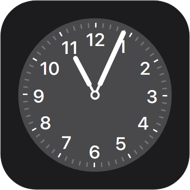 |
| [`TickClock`](./ClockCalendar/TickClock) | `TickClock` | 刻度时钟 `tick-clock-view` 2x2/4x4 | 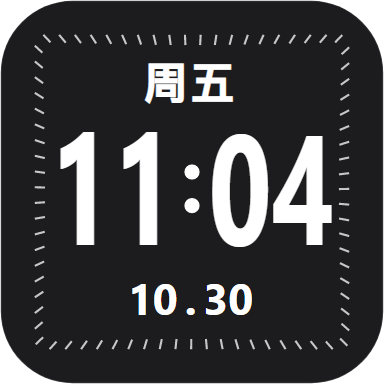 |

## Weather · 天气

| 组件 | 程序集 | 形态（尺寸） | 预览图 |
|---|---|---|---|
| [`Weather`](./Weather/Weather) | `Weather` | 预报 `forecast` 2x2/4x2/4x4 四日预报 `four-day-forecast` 2x2/3x3/4x4 温度 `temperature` 2x2 紫外线指数 `uv-index` 2x2 日出和日落 `sunrise-sunset` 2x2 气压 `pressure` 2x2 空气质量指数 `air-quality` 2x2 | 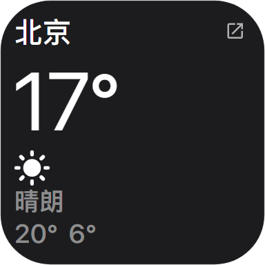 |

## SystemStatus · 系统状态

| 组件 | 程序集 | 形态（尺寸） | 预览图 |
|---|---|---|---|
| [`Batteries`](./SystemStatus/Batteries) | `Batteries` | 电池与外设 `batteries-view` 2x2/4x2/4x4 | 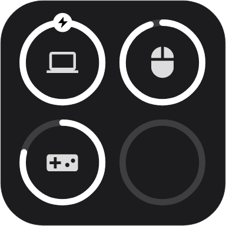 |
| [`ControlCenter`](./SystemStatus/ControlCenter) | `ControlCenter` | 控制中心 `control-center-view` 2x2/4x2/4x4 快捷控制磁贴 `single-control-view` 1x1/1x2/2x1/2x2 | 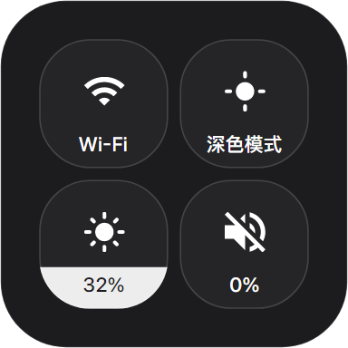 |
| [`Monitor`](./SystemStatus/Monitor) | `Monitor` | 单指标 `single-metric` 2x2 多指标看板 `multi-dashboard` 2x2/4x2/4x4 | 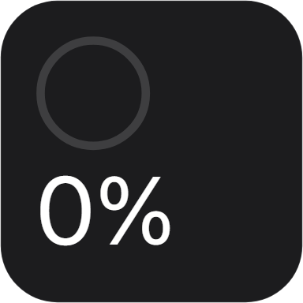 |
| [`Storage`](./SystemStatus/Storage) | `Storage` | 磁盘存储 `storage-view` 1x1/2x1/2x2/4x2/4x4 | 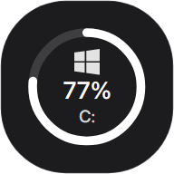 |

## Productivity · 任务效率

| 组件 | 程序集 | 形态（尺寸） | 预览图 |
|---|---|---|---|
| [`Countdown`](./Productivity/Countdown) | `Countdown` | 倒数纪念日 `countdown-view` 2x2/4x2/4x4 | 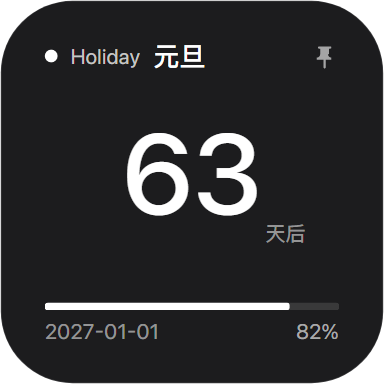 |
| [`Habits`](./Productivity/Habits) | `Habits` | 打卡 `habits-view` 1x1/2x2/4x2/4x4 | 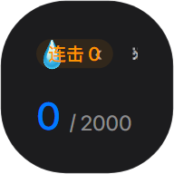 |
| [`Notes`](./Productivity/Notes) | `Notes` | 笔记 `note` 2x2/4x4 | 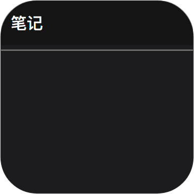 |
| [`Pomodoro`](./Productivity/Pomodoro) | `Pomodoro` | 番茄钟 `pomodoro-view` 2x2/4x2/4x4 | 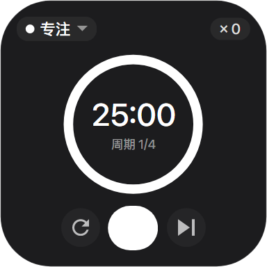 |
| [`Reminders`](./Productivity/Reminders) | `Reminders` | 清单 `list` 2x2/4x2/4x4 | 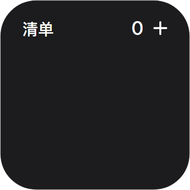 |
| [`TimeProgress`](./Productivity/TimeProgress) | `Progress` | 时间进度 `progress-view` 2x2/4x2/4x4 | 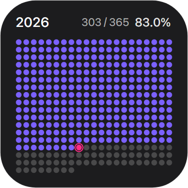 |
| [`Timetable`](./Productivity/Timetable) | `Timetable` | 课程表 `timetable-view` — |  |

## Launcher · 快捷启动

| 组件 | 程序集 | 形态（尺寸） | 预览图 |
|---|---|---|---|
| [`Folders`](./Launcher/Folders) | `Folders` | 文件展示框 `folder` 2x2/4x2/4x4 大文件夹 `big-folder` 2x2/4x2/4x4 单文件 `single-file` 1x1/2x2 单链接 `single-link` 1x1/2x2 | 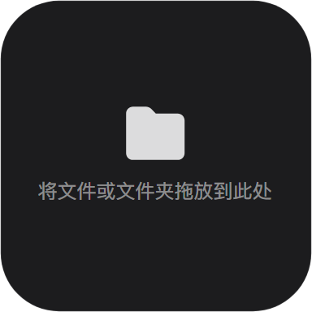 |
| [`Search`](./Launcher/Search) | `Search` | 搜索 `search-view` 2x2/4x1/4x2/4x4 |  |
| [`Shortcuts`](./Launcher/Shortcuts) | `Shortcuts` | 快捷指令 `shortcuts-view` 1x1/2x2/4x2/4x4 |  |

## Lifestyle · 媒体与生活

| 组件 | 程序集 | 形态（尺寸） | 预览图 |
|---|---|---|---|
| [`AudioVisualizer`](./Lifestyle/AudioVisualizer) | `AudioVisualizer` | 音频律动 `audio-visualizer-view` 2x1/2x2/4x2/4x4/6x2/6x3/8x2 | 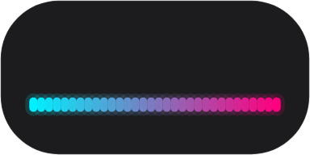 |
| [`Hitokoto`](./Lifestyle/Hitokoto) | `Hitokoto` | 一言 `hitokoto-view` 2x1/2x2/4x2/4x4 |  |
| [`Map`](./Lifestyle/Map) | `Map` | 地图 `map-view` 2x2/4x2/4x4 | 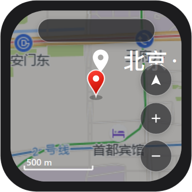 |
| [`Music`](./Lifestyle/Music) | `Music` | 音乐播放器 `music` 2x2/4x2/4x4 | 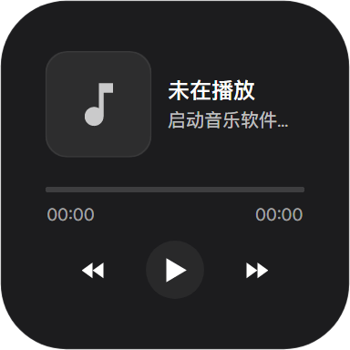 |
| [`Picture`](./Lifestyle/Picture) | `Picture` | 画框相册 `picture-view` 2x2/4x2/4x4 | 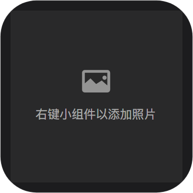 |

## Utilities · 实用工具

| 组件 | 程序集 | 形态（尺寸） | 预览图 |
|---|---|---|---|
| [`Toolbox`](./Utilities/Toolbox) | `Tools` | 剪贴板 `clipboard-view` 2x2/4x2/4x4 翻译 `translator-view` 2x2/4x2/4x4 计算器 `calculator-view` 2x2/4x2/4x4 | 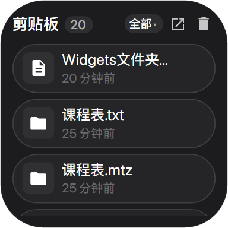 |

## Container · 容器组合

| 组件 | 程序集 | 形态（尺寸） | 预览图 |
|---|---|---|---|
| [`Aggregate`](./Container/Aggregate) | `FixedWidgets` | 聚合信息 `aggregate-view` 4x2 | 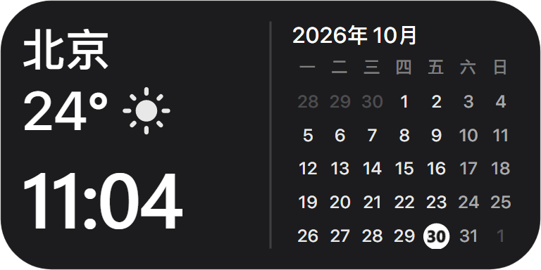 |
| [`Stack`](./Container/Stack) | `StackWidgets` | 组件重叠 `widget-stack-view` 2x2/4x2/4x4 |  |
